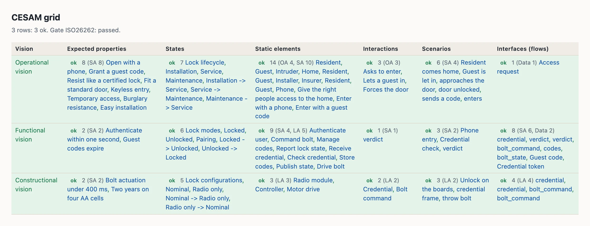
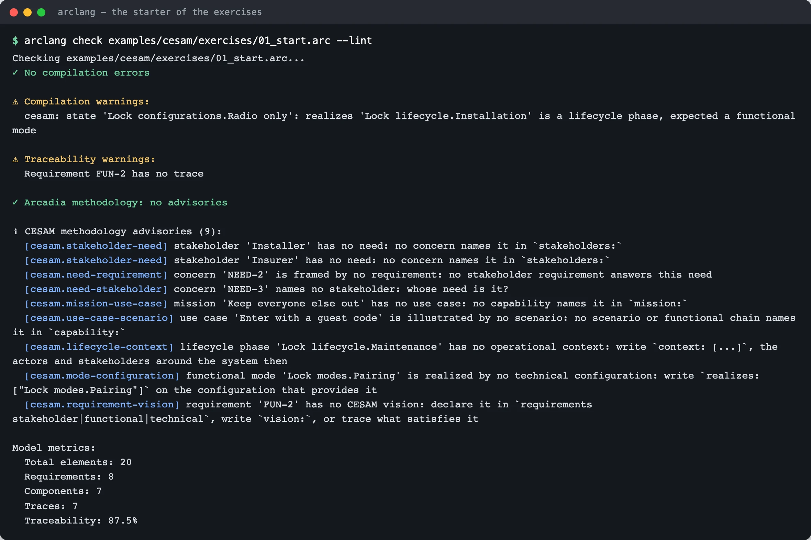
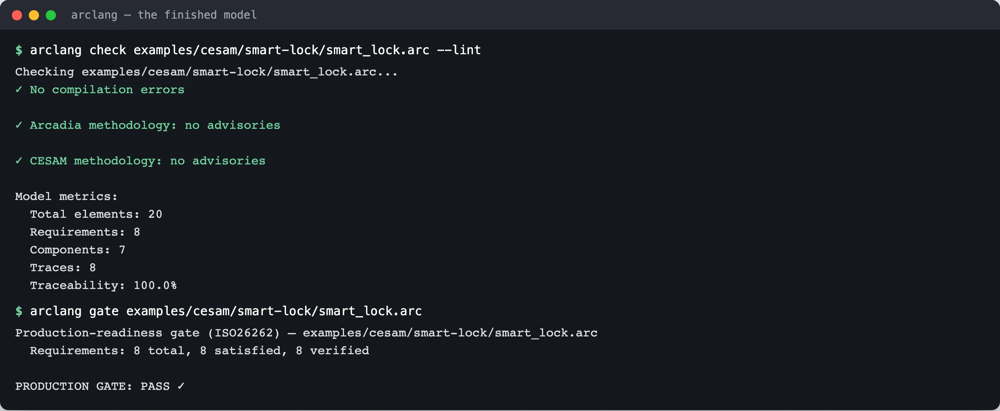
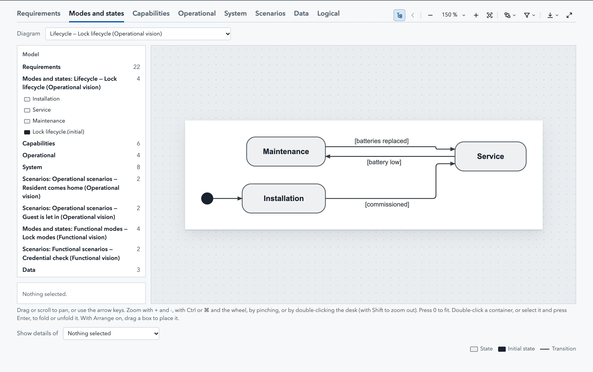
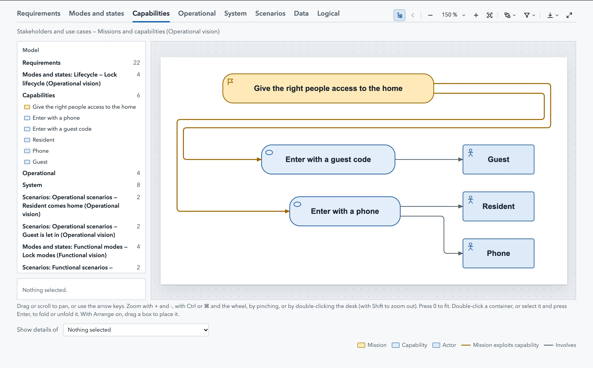
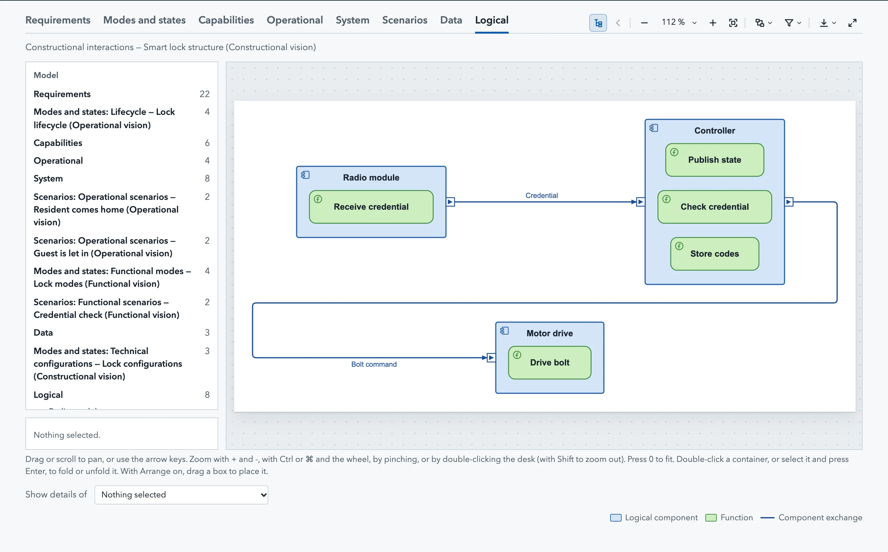

# CESAM tutorial: the three visions on one model

In this tutorial you take a model that **misses what the CESAM method asks
for**, and fill it in, one exercise at a time, until the compiler finds nothing
left to ask. On the way you read the CESAM grid of a model, scope it to a
system of interest, draw the CESAM diagram set, and export the views to
SysML v2. Every command on this page is run by a test of the repository
(`tests/cesam_exercises.rs`): what it shows is what the compiler prints.

It takes about an hour. You need the compiler (`cargo build --release`, or a
[release](https://github.com/Mbaroudi/arclang/releases)) and the files of
`examples/cesam/`:

| File | What it is |
|---|---|
| `examples/cesam/smart-lock/smart_lock.arc` | A connected door lock, complete: every view of the grid filled, every rule held |
| `examples/cesam/exercises/01_start.arc` | The same lock with the holes the exercises fill |
| `examples/cesam/exercises/solutions/after_ex2.arc` … `after_ex5.arc` | The model after each exercise, cumulative: compare yours with `diff` |

The commands below are run from the root of the repository. If CESAM is new to
you, read [cesam.md](cesam.md) first: it gives the grid, what each element kind
is placed in, and the method's rules.

## The grid in one paragraph

CESAM (CESAMES Systems Architecting Method) looks at a system under three
**visions**: operational (why the system exists: its stakeholders, their needs,
its use cases), functional (what it does: functions, modes, flows) and
constructional (how it is built: components, configurations, interfaces). Each
vision is described through six **aspects**: expected properties, states,
static elements, interactions, scenarios, interfaces. That is eighteen views,
the CESAM grid. An Arcadia model holds all of them; ArcLang computes the grid
from the layers you write and tells you which views are empty, which are
pending the production gate, and which are done.



## Exercise 1: read the grid of a model you already have

The grid needs no change to a model. Ask for it on an Arcadia example of the
repository, the emergency braking system:

```console
$ arclang table examples/automotive/emergency-braking/complete_emergency_braking_simple.arc --kind cesam_grid -f md --columns vision,requirements,states,scenarios
## CESAM grid

3 rows: 0 ok, 3 with a gap. Gate ISO26262: passed.

| Vision | Expected properties | States | Scenarios |
| --- | --- | --- | --- |
| Operational vision | — | — | — |
| Functional vision | — | 10: AEBOperatingModes, Standby, Warning, EmergencyBraking, Failed, Standby -> Warning, Warning -> EmergencyBraking, EmergencyBraking -> Standby, EmergencyBraking -> Standby, Standby -> Failed | 1 (SA 1): EmergencyBrakingChain |
| Constructional vision | 7 (SA 7): Obstacle detection range, Sensor fusion latency, Collision risk assessment, Emergency braking activation, Driver warning, Driver override, Health monitoring | — | 6 (LA 5): EmergencyStop, raw radar targets, fused object list, collision warning, critical threat, full braking force |
```

Each cell starts with how much the view holds and at which levels (`4 (SA 2,
LA 2)` is four elements, two of system analysis and two of logical
architecture), then names them. A dash is a view with nothing in it yet.

Now ask what CESAM would expect of that model. The `--method cesam` option
reports the method's rules on a model that does not declare the method:

```console
$ arclang check examples/automotive/emergency-braking/complete_emergency_braking_simple.arc --lint --method cesam | sed -n '/CESAM/,/^$/p'
ℹ CESAM methodology advisories (7):
  [cesam.view-empty] CESAM view 'Stakeholder requirements' (Operational vision · Expected properties) is empty: model it (requirements (stakeholder))
  [cesam.view-empty] CESAM view 'Lifecycle' (Operational vision · States) is empty: model it ([M&S] Mode State Machine)
  [cesam.view-empty] CESAM view 'Operational scenarios' (Operational vision · Scenarios) is empty: model it ([ES] Exchange Scenario)
  [cesam.view-empty] CESAM view 'Operational interfaces' (Operational vision · Interfaces (flows)) is empty: model it ([CDB] Class Diagram Blank)
  [cesam.view-empty] CESAM view 'Functional requirements' (Functional vision · Expected properties) is empty: model it (requirements (system))
  [cesam.view-empty] CESAM view 'Technical configurations' (Constructional vision · States) is empty: model it ([M&S] Mode State Machine)
  [cesam.use-case-scenario] use case 'EmergencyBraking' is illustrated by no scenario: no scenario or functional chain names it in `capability:`
```

Every empty view is named with the Capella diagram that draws it, and what
holds a rule (here, use cases that no scenario illustrates) is named element by
element. **What to notice:** the model is a good Arcadia model (the gate passes)
and still answers "why?" only in part: no stakeholder requirements, no
lifecycle. That is what the CESAM lens adds.

## Exercise 2: stakeholders and their needs

Open `examples/cesam/exercises/01_start.arc`. It declares `method: "cesam"`, so
every `check` reports the method's rules without any option. Copy it to a
file of yours and run:

```console
$ arclang check examples/cesam/exercises/01_start.arc --lint | sed -n '/CESAM/,/^$/p'
ℹ CESAM methodology advisories (9):
  [cesam.stakeholder-need] stakeholder 'Installer' has no need: no concern names it in `stakeholders:`
  [cesam.stakeholder-need] stakeholder 'Insurer' has no need: no concern names it in `stakeholders:`
  [cesam.need-requirement] concern 'NEED-2' is framed by no requirement: no stakeholder requirement answers this need
  [cesam.need-stakeholder] concern 'NEED-3' names no stakeholder: whose need is it?
  [cesam.mission-use-case] mission 'Keep everyone else out' has no use case: no capability names it in `mission:`
  [cesam.use-case-scenario] use case 'Enter with a guest code' is illustrated by no scenario: no scenario or functional chain names it in `capability:`
  [cesam.lifecycle-context] lifecycle phase 'Lock lifecycle.Maintenance' has no operational context: write `context: [...]`, the actors and stakeholders around the system then
  [cesam.mode-configuration] functional mode 'Lock modes.Pairing' is realized by no technical configuration: write `realizes: ["Lock modes.Pairing"]` on the configuration that provides it
  [cesam.requirement-vision] requirement 'FUN-2' has no CESAM vision: declare it in `requirements stakeholder|functional|technical`, write `vision:`, or trace what satisfies it
```



Nine advisories. The first four belong to the **stakeholder analysis** of the
operational vision. CESAM asks that every stakeholder have at least one need,
that every need belong to someone, and that every need be answered by a
stakeholder requirement. In ArcLang a need is a `concern` naming its
stakeholders, and a requirement answers it with `frames:`.

In `requirements stakeholder { }` of your copy:

1. Give the insurer and the resident back their need: write
   `stakeholders: ["STK-INSR", "STK-RES"]` on the concern `NEED-3`.
2. Give the installer a need: add
   `concern "Easy installation" { id: "NEED-4" stakeholders: ["STK-INS"] }`.
3. Let the requirements answer the needs: add `frames: ["NEED-2"]` to
   `STK-REQ-2` and `frames: ["NEED-4"]` to `STK-REQ-4`.

```arclang
requirements stakeholder {
    stakeholder "Installer" { id: "STK-INS" category: "maintainer" interest: "Fits the lock in a standard door in under an hour" influence: Medium }

    concern "Burglary resistance" { id: "NEED-3" stakeholders: ["STK-INSR", "STK-RES"] }
    concern "Easy installation" { id: "NEED-4" stakeholders: ["STK-INS"] }

    req "STK-REQ-4" "Fit a standard door" { priority: Medium frames: ["NEED-4"] description: "The lock fits a standard European door without drilling" }
}
```

Check your copy: the four advisories about needs are gone, five remain. The
solution is `solutions/after_ex2.arc`:

```console
$ arclang check examples/cesam/exercises/solutions/after_ex2.arc --lint | sed -n '/CESAM/,/^$/p'
ℹ CESAM methodology advisories (5):
  [cesam.mission-use-case] mission 'Keep everyone else out' has no use case: no capability names it in `mission:`
  [cesam.use-case-scenario] use case 'Enter with a guest code' is illustrated by no scenario: no scenario or functional chain names it in `capability:`
  [cesam.lifecycle-context] lifecycle phase 'Lock lifecycle.Maintenance' has no operational context: write `context: [...]`, the actors and stakeholders around the system then
  [cesam.mode-configuration] functional mode 'Lock modes.Pairing' is realized by no technical configuration: write `realizes: ["Lock modes.Pairing"]` on the configuration that provides it
  [cesam.requirement-vision] requirement 'FUN-2' has no CESAM vision: declare it in `requirements stakeholder|functional|technical`, write `vision:`, or trace what satisfies it
```

**Why it matters.** A stakeholder with no need is a name on a list; a need with
no requirement is never verified. The traceability of the operational vision
starts here: need → stakeholder requirement → use case (`trace "UC-1"
satisfies "STK-REQ-1"`) → test case.

## Exercise 3: missions, use cases and their scenarios

CESAM decomposes each **mission** of the system into **use cases** (Arcadia
capabilities, `mission:` names the mission), and illustrates each use case by
at least one **operational scenario**. The starter has a mission with no use
case and a use case with no scenario.

In `system_analysis` of your copy, add a use case for the second mission:

```arclang
capability "Refuse an intruder" { id: "UC-3" mission: "MIS-2" involves: ["SA-PHN"] }
```

Then, after the scenario "Resident comes home", write the scenarios of the two
use cases that have none. A scenario names its use case with `capability:`;
its participants are the actors of the system analysis:

```arclang
scenario "Guest is let in" {
    capability: "UC-2"
    participants: ["SA-GST", "SA-RES"]
    message "SA-RES" -> "SA-GST" "sends a code"
    message "SA-GST" -> "SA-RES" "enters"
}

scenario "An intruder tries" {
    capability: "UC-3"
    participants: ["SA-PHN"]
    message "SA-PHN" -> "SA-PHN" "unknown credential refused"
}
```

Three advisories remain:

```console
$ arclang check examples/cesam/exercises/solutions/after_ex3.arc --lint | sed -n '/CESAM/,/^$/p'
ℹ CESAM methodology advisories (3):
  [cesam.lifecycle-context] lifecycle phase 'Lock lifecycle.Maintenance' has no operational context: write `context: [...]`, the actors and stakeholders around the system then
  [cesam.mode-configuration] functional mode 'Lock modes.Pairing' is realized by no technical configuration: write `realizes: ["Lock modes.Pairing"]` on the configuration that provides it
  [cesam.requirement-vision] requirement 'FUN-2' has no CESAM vision: declare it in `requirements stakeholder|functional|technical`, write `vision:`, or trace what satisfies it
```

**What to notice.** A scenario between actors is an *operational* scenario; the
grid places a scenario by its participants (actors: operational; functions:
functional; components: constructional) unless you write `vision:`. Draw them
with `arclang diagram --view cesam` (exercise 7): they come out titled
"Operational scenarios".

## Exercise 4: lifecycle, functional modes, technical configurations

The three visions each have their **states**: the operational vision has the
system's **lifecycle** (installation, service, maintenance…), the functional
vision its **functional modes** (locked, unlocked, pairing), the constructional
vision its **technical configurations** (which boards are powered). CESAM ties
them: a mode is available *during* lifecycle phases, a configuration
*realizes* modes, a lifecycle phase has an operational *context* (who is
around the system then).

In ArcLang the `kind:` of a state machine says which of the three it is, and
`context:`, `during:` and `realizes:` tie the states. The starter breaks two
ties and gets one wrong. Look at the first lines of the check again:

```console
$ arclang check examples/cesam/exercises/01_start.arc --lint | sed -n '/Compilation warnings/,/^$/p'
⚠ Compilation warnings:
  cesam: state 'Lock configurations.Radio only': realizes 'Lock lifecycle.Installation' is a lifecycle phase, expected a functional mode
```

A configuration that realizes a lifecycle phase is not an error of the
language, it is an error of the method, so the compiler reports it as a warning
(`cesam.role`). In your copy:

1. Give the maintenance phase its context: `state Maintenance { context: ["STK-INS"] }`.
2. Make the "Radio only" configuration realize the pairing *mode*, not the
   installation *phase*: `state "Radio only" { realizes: ["Lock modes.Pairing"] }`.

```arclang
state_machine "Lock lifecycle" {
    kind: "lifecycle"
    initial: "Installation"
    state Installation { context: ["STK-INS", "OA-HOME"] }
    state Service { context: ["OA-RES", "OA-GST", "OA-INT"] }
    state Maintenance { context: ["STK-INS"] }
}

state_machine "Lock configurations" {
    kind: "technical_configurations"
    initial: "Nominal"
    state Nominal { realizes: ["Lock modes.Locked", "Lock modes.Unlocked"] }
    state "Radio only" { realizes: ["Lock modes.Pairing"] }
}
```

One advisory remains, and the warning is gone:

```console
$ arclang check examples/cesam/exercises/solutions/after_ex4.arc --lint | sed -n '/CESAM/,/^$/p'
ℹ CESAM methodology advisories (1):
  [cesam.requirement-vision] requirement 'FUN-2' has no CESAM vision: declare it in `requirements stakeholder|functional|technical`, write `vision:`, or trace what satisfies it
```

**A tie to nothing is an error.** Write `realizes: ["Lock modes.Sleeping"]` on a
configuration and the model no longer compiles; so does a `kind:` outside
`lifecycle`, `functional_modes`, `technical_configurations` (and their French
names). Try it on a copy:

```console
$ sed 's/kind: "technical_configurations"/kind: "phases"/' examples/cesam/exercises/solutions/after_ex4.arc > /tmp/cesam_wrong_kind.arc; arclang check /tmp/cesam_wrong_kind.arc
Checking /tmp/cesam_wrong_kind.arc...
✗ Check failed: Semantic error: state machine 'Lock configurations': kind 'phases' is not one of lifecycle, functional_modes, technical_configurations
Error: Compilation error: Semantic error: state machine 'Lock configurations': kind 'phases' is not one of lifecycle, functional_modes, technical_configurations
```

## Exercise 5: every requirement in its vision

The last advisory is about `FUN-2`. CESAM sorts expected properties into
stakeholder requirements (operational), functional requirements and technical
requirements (constructional). ArcLang places a requirement by the block that
declares it (`requirements stakeholder|functional|technical`), else by its
`vision:`, else by what satisfies it (a function: functional; a component:
constructional). `FUN-2` sits in a plain `requirements { }` block and nothing
satisfies it, so the compiler cannot place it.

Two fixes are right; do both in your copy: move `FUN-2` into the
`requirements functional { }` block, and trace the function that satisfies it,
`trace "LF-2" satisfies "FUN-2" {}`. The second also answers the traceability
warning of the production gate.

```console
$ arclang check examples/cesam/exercises/solutions/after_ex5.arc --lint
Checking examples/cesam/exercises/solutions/after_ex5.arc...
✓ No compilation errors

✓ Arcadia methodology: no advisories

✓ CESAM methodology: no advisories

Model metrics:
  Total elements: 20
  Requirements: 8
  Components: 7
  Traces: 8
  Traceability: 100.0%
```

Nothing left to ask. The model now passes the production gate too:

```console
$ arclang gate examples/cesam/exercises/solutions/after_ex5.arc
Production-readiness gate (ISO26262) — examples/cesam/exercises/solutions/after_ex5.arc
  Requirements: 8 total, 8 satisfied, 8 verified

PRODUCTION GATE: PASS ✓
```



Compare your copy with the solution: `diff my_lock.arc
examples/cesam/exercises/solutions/after_ex5.arc` should show only the
differences you meant. (The solution has one mission, one use case and one
scenario more than `smart_lock.arc`: the ones exercise 3 added. Everything else
is the same text.)

## Exercise 6: the system of interest

A CESAM grid is drawn for one **system of interest**. The whole lock is one;
its controller board is another, with its own three visions. The `--scope`
option keeps one element and what it holds, plus every exchange that crosses
its boundary (an interface of the controller is a flow to or from it):

```console
$ arclang table examples/cesam/smart-lock/smart_lock.arc --kind cesam_grid -f md --scope LC-2
## CESAM grid

3 rows: 0 ok, 3 with a gap. Gate ISO26262: passed.

| Vision | Expected properties | States | Static elements | Interactions | Scenarios | Interfaces (flows) |
| --- | --- | --- | --- | --- | --- | --- |
| Operational vision | — | — | — | — | — | — |
| Functional vision | — | — | 3 (LA 3): Check credential, Store codes, Publish state | — | — | — |
| Constructional vision | — | — | 1 (LA 1): Controller | 2 (LA 2): Credential, Bolt command | 2 (LA 2): credential frame, throw bolt | 2 (LA 2): credential, bolt_command |
```

The controller holds functions (functional structure), it is a component
(constructional structure), two exchanges cross its boundary, one scenario
passes through it. Its operational vision is empty: nobody wrote why the
*controller* exists, as opposed to why the lock does. That is a true gap of the
model, and the grid shows it.

`--scope` also takes an Arcadia level (`OA`, `SA`, `LA`, `PA`, `EPBS`), so you can
see how far one level goes into each vision:

```console
$ arclang table examples/cesam/smart-lock/smart_lock.arc --kind cesam_grid -f md --scope LA --columns vision,structure,interactions,interfaces
## CESAM grid

3 rows: 1 ok, 2 with a gap. Gate ISO26262: passed.

| Vision | Static elements | Interactions | Interfaces (flows) |
| --- | --- | --- | --- |
| Operational vision | — | — | — |
| Functional vision | 5 (LA 5): Receive credential, Check credential, Store codes, Publish state, Drive bolt | — | — |
| Constructional vision | 3 (LA 3): Radio module, Controller, Motor drive | 2 (LA 2): Credential, Bolt command | 4 (LA 4): credential, credential, bolt_command, bolt_command |
```

## Exercise 7: the CESAM diagram set

The `--view cesam` option of `arclang diagram` draws the Capella diagrams that
CESAMES maps to each view (lifecycle, use cases, environment, scenarios, modes,
data, configurations, architecture), titles each by its CESAM view and vision,
and orders them by the grid:

```console
$ arclang diagram examples/cesam/smart-lock/smart_lock.arc -f html -o /tmp/smart_lock_cesam.html --view cesam
✓ req — 22 nodes, 18 edges
✓ msm:Lock lifecycle — 4 nodes, 4 edges
✓ cap — 6 nodes, 5 edges
✓ oab — 4 nodes, 3 edges
✓ sab — 8 nodes, 1 edges
✓ es:Resident comes home — 2 nodes, 2 edges
✓ es:Guest is let in — 2 nodes, 2 edges
✓ msm:Lock modes — 4 nodes, 3 edges
✓ es:Credential check — 2 nodes, 1 edges
✓ cdb — 3 nodes, 0 edges
✓ msm:Lock configurations — 3 nodes, 3 edges
✓ lab — 8 nodes, 2 edges
✓ es:Unlock on the boards — 3 nodes, 2 edges
  Output: /tmp/smart_lock_cesam.html
```

Open `/tmp/smart_lock_cesam.html` in a browser: one tab per kind of diagram, a
list under the tab when the kind holds several (the three state machines, the
four scenarios). The page needs no network.







**What to look for.** Follow the credential across the visions: in the
operational scenarios the resident approaches the door; in the functional
scenario `Authenticate user` sends its verdict to `Command bolt`; in the
constructional scenario the radio module sends a frame to the controller, which
tells the motor drive to throw the bolt. Three visions, one event.

## Exercise 8: the views in SysML v2

A model following CESAM exports each view of its grid as a SysML v2 `view`
that exposes the elements placed in it, with its vision and aspect as
attributes. A tool reading the SysML (Cameo, Enterprise Architect, Rhapsody)
gets the model organized the CESAM way:

```console
$ out=$(mktemp -d) && arclang export examples/cesam/smart-lock/smart_lock.arc -f sys-ml -o $out/smart_lock.sysml > /dev/null && grep -A 3 "view 'CESAM Lifecycle'" $out/smart_lock.sysml && grep -c "view 'CESAM" $out/smart_lock.sysml
    view 'CESAM Lifecycle' {
        attribute vision : String = "operational";
        attribute aspect : String = "states";
        expose Behaviors::'Lock lifecycle';
15
```

Eighteen views would be the whole grid; the export writes the ones that hold
something. The SysML reads back into ArcLang with `arclang import -f sysml`.

## Exercise 9: start a model of your own

`arclang new` writes a model following CESAM from a template: one section per
vision, every element a placeholder to rename, which compiles and holds every
rule from the first line:

```console
$ cd $(mktemp -d) && arclang new door --template cesam && arclang check door.arc --lint | sed -n '/CESAM/,/^$/p'
✓ door.arc written from the cesam template
  arclang check door.arc --lint
  arclang table door.arc --kind cesam_grid -f md
✓ CESAM methodology: no advisories
```

Rename the placeholders, then let the grid and the advisories tell you what is
missing as you go. In VS Code, the table view offers the kind *CESAM grid* and
redraws it as you type. For an agent, the MCP server's `arclang_cesam` tool
returns the grid and the advisories as JSON; the command line gives the same
with `arclang table --kind cesam_grid -f json` and `arclang check --json`:

```console
$ arclang check examples/cesam/exercises/01_start.arc --json | python3 -c "import json,sys; f=[x for x in json.load(sys.stdin)['findings'] if x['rule'].startswith('cesam.')]; print(len(f), 'CESAM findings; first:', f[0]['rule'], '-', f[0]['element'])"
10 CESAM findings; first: cesam.role - Lock configurations.Radio only
```

## Where to go next

- [cesam.md](cesam.md): the reference, the mapping of every element kind, the rules.
- `arclang rules` and `arclang metamodel`: the `cesam.*` rules and the
  `CESAM:` line of every kind, generated from the compiler.
- The smart lock example, complete: `examples/cesam/smart-lock/smart_lock.arc`.
- `tools/cesam_screenshots.mjs` regenerates the screenshots of this page from
  the compiler; `cargo test --test cesam_exercises` runs its commands.
