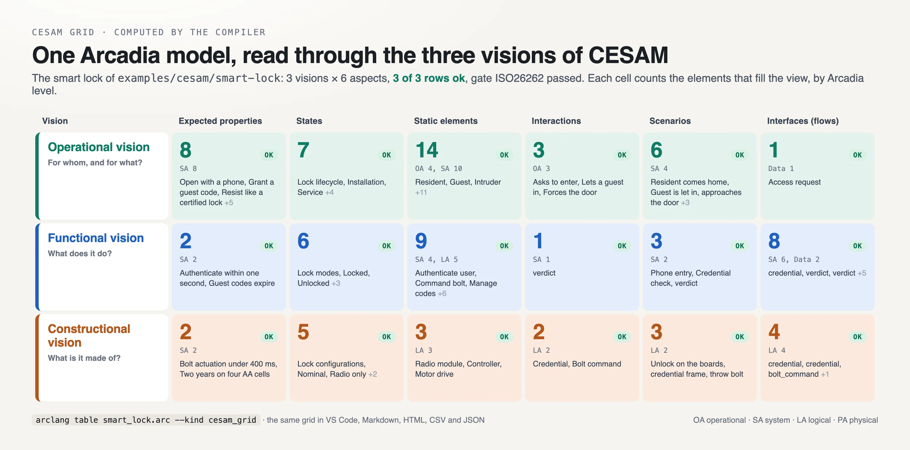
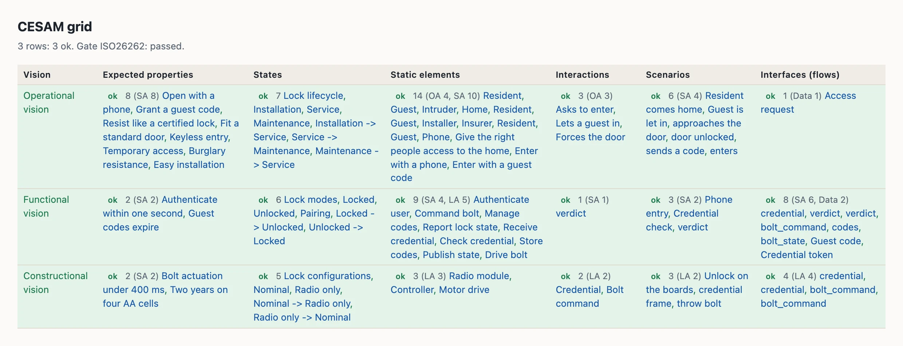
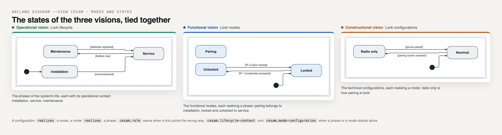
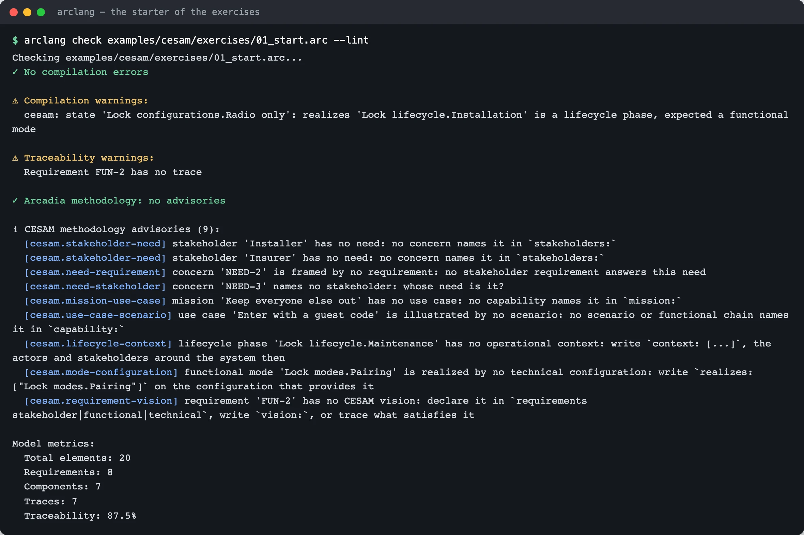
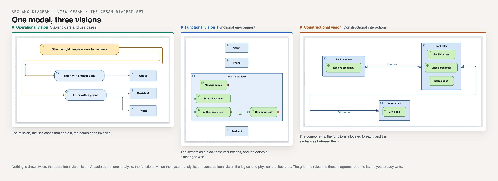

# CESAM in ArcLang

[CESAM](https://www.cesames.net/le-cadre-cesam/) (CESAMES Systems Architecting
Method) and Arcadia describe a system with the same content, organized
differently. An Arcadia layer (operational analysis, system analysis, logical
and physical architectures) is **one abstraction level covering several
perspectives**; a CESAM vision is **one perspective covering several
levels**. ArcLang keeps one model and shows it both ways: the Arcadia layers
you write, and the CESAM grid the compiler computes from them.

This page is the reference. To learn by doing, follow the
[CESAM tutorial](cesam-tutorial.md): nine exercises, each checked by the compiler.



## The grid

CESAM studies any system under three visions, each seen through six aspects:

| Vision | Question | Expected properties | States | Static elements | Interactions | Scenarios | Interfaces (flows) |
|---|---|---|---|---|---|---|---|
| **Operational** | why? | stakeholder requirements | lifecycle | stakeholders, use cases | environment | operational scenarios | operational interfaces |
| **Functional** | what? | functional requirements | functional modes | functional breakdown | functional interactions | functional scenarios | functional interfaces |
| **Constructional** | how? | technical requirements | technical configurations | product breakdown | constructional interactions | constructional scenarios | constructional interfaces |

```
arclang table model.arc --kind cesam_grid -f md      # or json, csv, html, xlsx
arclang table model.arc --kind cesam_grid --scope LA # one abstraction level
arclang table model.arc --kind cesam_grid --scope "Controller"   # one system of interest
```

Each cell lists the elements and exchanges of that view and says how mature it
is: **gap** when nothing is modelled yet (the issue names the Capella diagram
that draws it), **pending** when the production gate flags one of its elements,
**ok** otherwise. Each cell also counts its elements per Arcadia level, so the
grid shows how deep each perspective goes. In VS Code the table view offers the
kind *CESAM grid*; in a generated document, `{{table cesam_grid}}`.



### Where each element goes

Every kind of the metamodel names its cell (the `CESAM:` line of
[spec/METAMODEL.md](https://github.com/Mbaroudi/arclang/blob/main/spec/METAMODEL.md)). A few kinds are placed by what the
element is about:

- **Requirements**: by `vision:`, else by their block: `requirements
  stakeholder { }` is operational, `requirements functional { }` (or `system`)
  functional, `requirements technical { }` constructional; else by what
  satisfies them (a function: functional, a component: constructional).
- **State machines**: by `kind:` — `lifecycle`, `functional_modes`,
  `technical_configurations` — else by their name ("... lifecycle",
  "... configurations"), else functional modes.
- **Scenarios**: by `vision:`, else by their participants: between functions,
  functional; between components, constructional; else operational.
- **Exchange items and classes**: by the exchanges they type.

## What CESAM adds to the language

```arclang
model SmartLock { method: "cesam" }

requirements stakeholder {
    stakeholder "Resident" { id: "STK-RES" category: "user" interest: "Enters without a key" influence: High }
    concern "Keyless entry" { id: "NEED-1" stakeholders: ["STK-RES"] }   // the stakeholder's need
    req "STK-REQ-1" "Open with a phone" { priority: High frames: ["NEED-1"] }
}

state_machine "Lock lifecycle" {
    kind: "lifecycle"
    initial: "Installation"
    state Installation { context: ["STK-INS"] }        // the operational context of the phase
    state Service { context: ["OA-RES", "OA-INT"] }
}

state_machine "Lock modes" {
    kind: "functional_modes"
    initial: "Locked"
    mode Locked { during: ["Lock lifecycle.Service"] }  // when the mode is available
}

state_machine "Lock configurations" {
    kind: "technical_configurations"
    initial: "Nominal"
    state Nominal { realizes: ["Lock modes.Locked"] }   // the modes the configuration provides
}

scenario "Resident comes home" { capability: "UC-1" participants: ["SA-RES", "SA-PHN"] }
```

- `stakeholder` (in a `requirements` or `system_analysis` block): who the system
  matters to. A `concern` naming it in `stakeholders:` is its **need**; the
  requirements that `frames:` the concern are its stakeholder requirements.
  Exported to SysML v2 as a `part def`.
- `kind:` on a state machine gives it its CESAM role; a value outside
  `lifecycle`, `functional_modes`, `technical_configurations` is an error.
- `realizes:`, `during:` and `context:` on states tie configurations to modes,
  modes to lifecycle phases, phases to their operational context. A reference to
  nothing is an error; to a state of another role (a configuration realizing a
  lifecycle phase), a warning (`cesam.role`).
- `vision:` on a requirement, a scenario or a state machine overrides what the
  compiler infers.
- `capability:` on a scenario names the use case it illustrates.



## The method's rules

`arclang check model.arc --lint --method cesam` reports what CESAM expects and
the model does not have yet. A model declaring `method: "cesam"` gets them on
every `check`, in `check --json` findings, and as warnings of the production
gate (`methodology.cesam`). `arclang rules` documents each:

| Rule | Asks for |
|---|---|
| `cesam.view-empty` | every view of the grid modelled |
| `cesam.stakeholder-need` | a need (concern) for every stakeholder |
| `cesam.need-stakeholder` | a stakeholder for every need |
| `cesam.need-requirement` | a requirement framing every need |
| `cesam.mission-use-case` | a use case (capability) for every mission |
| `cesam.use-case-scenario` | a scenario (or functional chain) illustrating every use case |
| `cesam.lifecycle-context` | an operational context for every lifecycle phase |
| `cesam.mode-configuration` | a technical configuration realizing every functional mode |
| `cesam.requirement-vision` | a vision for every requirement |
| `cesam.role` | relations between states of the right roles |



## Diagrams

`arclang diagram model.arc -o views.html -f html --view cesam` draws the
viewpoint diagrams of the CESAM views, titled and ordered by the grid
(lifecycle, use cases, environment, operational scenarios, then the functional,
then the constructional views). The mapping follows CESAMES' *CESAM + Capella*
webinar (2023):

| CESAM view | Capella diagrams | ArcLang view |
|---|---|---|
| Stakeholders and use cases | OEBD, CSA, MCB | `cap` |
| Environment diagram | OAB, SAB | `oab`, `sab` |
| Lifecycle, functional modes, technical configurations | M&S | `msm:<machine>` by its `kind:` |
| Operational, functional, constructional scenarios | ES, FS | `es:<scenario>` by its vision |
| Constructional interactions | LAB, PAB | `lab`, `pab` |
| Product breakdown | LCBD, PCBD, EPBS | `pbs` |
| Interfaces | CDB | `cdb` |



## Starting a model

`arclang new door --template cesam` writes `door.arc`: a model following CESAM
with one section per vision, each element a placeholder to rename, which
compiles and passes `check --lint`. The complete example is
[examples/cesam/smart-lock/smart_lock.arc](https://github.com/Mbaroudi/arclang/blob/main/examples/cesam/smart-lock/smart_lock.arc).
The [CESAM tutorial](cesam-tutorial.md) takes a model with holes and fills it,
exercise by exercise, with screenshots of every step.

## Agents

The MCP server's `arclang_cesam` tool returns the grid of a model with the
method's advisories, so an agent can answer "what is missing in my functional
vision?" from what the compiler computes.
