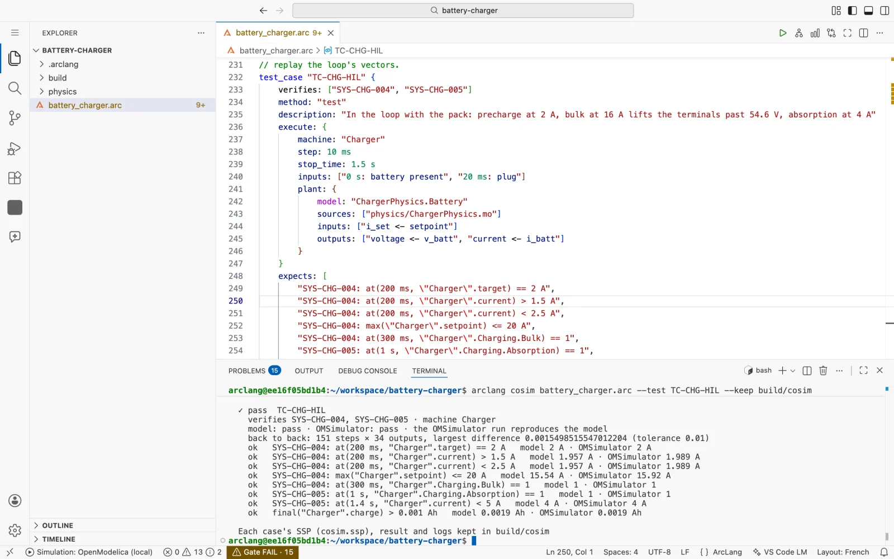
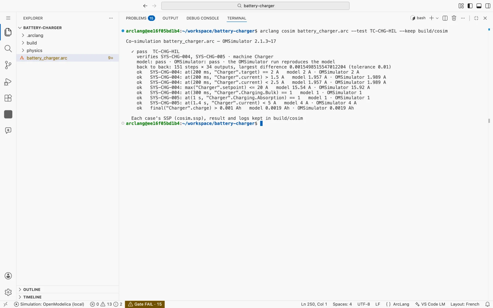
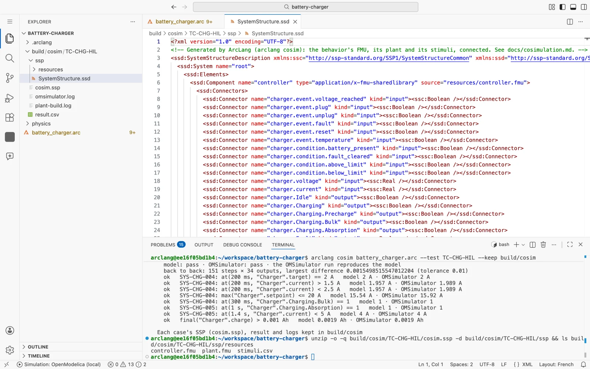
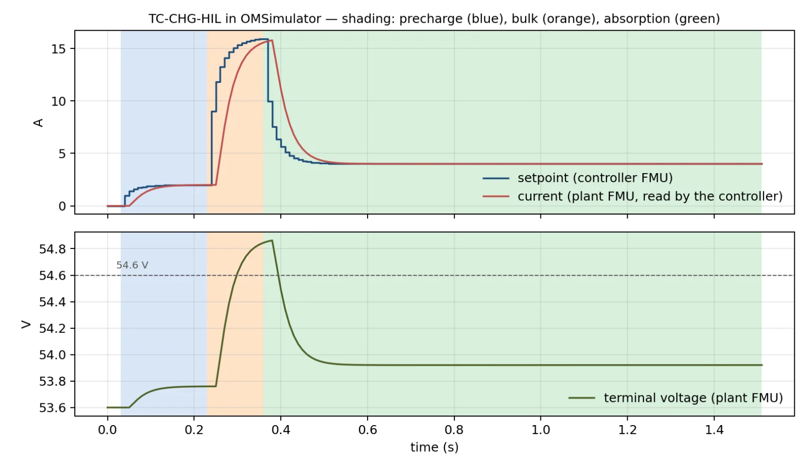

# Co-simulation in OMSimulator

`arclang cosim` runs a model's executed test cases as a standard FMI
co-simulation, in **OMSimulator**, OpenModelica's FMI and SSP master, and
judges the run as `arclang sil` judges the C: the case's `expects:` on it,
and its trace step by step against the model.

```text
arclang cosim model.arc                    every case that execute:s
arclang cosim model.arc --test TC-CHG-HIL  one case
arclang cosim model.arc --keep build/cosim the SSP, the result and the logs kept
arclang cosim model.arc --json             the outcomes as JSON
```

**Online.** On [arclang.fr](https://arclang.fr/playground/), signed in, the
**Simulate** button under the diagram runs these cases on the server too, in
OMSimulator, in the same run as the model's simulations: their verdicts show
in the notification and in the ArcLang Simulation log.

The point is that the behavior now runs **as an FMU, under a master that
is not ArcLang's**. The machine is exported as an FMI 2.0 co-simulation
FMU (`export -f fmu`), its plant as another FMU (OpenModelica's, or the
one the case gives, from Simulink, Dymola, Amesim…), and the two are
connected in an SSP package (System Structure and Parameterization 1.0)
that any SSP tool opens. What ArcLang proves on its own loop is then
proven again on the standard exchange.

## Tutorial: a charger and its battery in OMSimulator

About fifteen minutes. You need [ArcLang Studio](studio.md), which
holds the compiler, OpenModelica and OMSimulator, or a computer with all
three. The model is `examples/energy/battery-charger` of the repository:
the charge controller of a 48 V battery, written as a state machine
(precharge, bulk, absorption, a PID on the current, a voltage filter), and
its battery written in Modelica (`physics/ChargerPhysics.mo`).

**1. Open the example.** In Studio, open the folder
`examples/energy/battery-charger` and `battery_charger.arc`. Go to the
test case `TC-CHG-HIL`. Its `plant:` block says what is connected to what:
the controller's `setpoint` drives the battery's `i_set`, and the
battery's `v_batt` and `i_batt` come back as the controller's `voltage`
and `current`.



**2. Run the case in OMSimulator.** In the terminal:

```text
arclang cosim battery_charger.arc --test TC-CHG-HIL --keep build/cosim
```

The first run takes a minute: OpenModelica builds the battery as an FMU.
ArcLang compiles the controller as another FMU, puts both and the case's
inputs in `build/cosim/TC-CHG-HIL/cosim.ssp`, and OMSimulator runs it.



Read the verdict from the top:

- `model: pass · OMSimulator: pass`: the expectations hold on the model's
  own run and on OMSimulator's;
- `the OMSimulator run reproduces the model`: every one of the 34 outputs,
  at every one of the 151 steps, is within the tolerance (0.01 here,
  because the battery's integrator runs under two masters);
- one line per expectation, with its value on each run. The current at
  200 ms is 1.957 A on the model and 1.989 A on OMSimulator: both are
  within 1.5 .. 2.5 A, and the difference is the period of delay explained
  in "How the run is judged".

**3. Look inside the SSP.** `cosim.ssp` is a zip:

```text
unzip -o -q build/cosim/TC-CHG-HIL/cosim.ssp -d build/cosim/TC-CHG-HIL/ssp
```

`SystemStructure.ssd` lists the three components (`controller`, `plant`,
`stimuli`), every connector with its type, the connections and the
master's step. `resources/` holds the two FMUs and the table of inputs.
Any SSP tool opens the package, including OMSimulator on its own:
`OMSimulator cosim.ssp --stopTime=1.5 --stepSize=0.01`.



**4. Plot the run.** `build/cosim/TC-CHG-HIL/result.csv` is OMSimulator's
result, one column per variable of every component. The charger
precharges at 2 A, the setpoint jumps to bulk at 240 ms, the terminals
pass 54.6 V, and absorption holds 4 A:



**5. Run every case.** `arclang cosim battery_charger.arc` runs the four
cases. Three pass. `TC-CHG-002` is skipped: it goes through an
`io_binding`, and its channels are proven by `arclang sil`.

## Exercises

Each exercise uses the charger, except the last one. The solutions were
run in ArcLang Studio when this page was written.

**Exercise 1. What runs, what does not.** Run
`arclang cosim battery_charger.arc`. Which cases pass, which is skipped,
and why? What is the command's exit code?

<details>
<summary>Solution</summary>

TC-CHG-001, TC-CHG-003 and TC-CHG-HIL pass. TC-CHG-002 is skipped
(`– skip`): it goes through the `io_binding` "Charger board", and the FMU
exchanges the machine's variables, not its channels. A skipped case is not
a failure, so the exit code is 0.

</details>

**Exercise 2. Read the connections.** In `SystemStructure.ssd` of
TC-CHG-HIL, find the connections between `controller` and `plant`. Which
connector of the plant does the controller drive, and which of the
controller's connectors does the plant drive?

<details>
<summary>Solution</summary>

```text
controller.charger.setpoint  ->  plant.i_set
plant.v_batt                 ->  controller.charger.voltage
plant.i_batt                 ->  controller.charger.current
```

They are the case's `plant:` block, `inputs: ["i_set <- setpoint"]` and
`outputs: ["voltage <- v_batt", "current <- i_batt"]`, written as SSP
connections. Every other input of the controller is connected to the
`stimuli` table.

</details>

**Exercise 3. See the period of delay.** In `result.csv`, compare the
controller's `setpoint` and the plant's `i_set` at 230, 240 and 250 ms
(take the first row of each instant). What do you see, and why?

<details>
<summary>Solution</summary>

```text
t (s)   charger.setpoint   plant.i_set
0.23    1.99907            1.99867
0.24    8.99935            1.99907
0.25    11.79955           8.99935
```

The plant receives the setpoint one period after the controller computes
it. OMSimulator steps both FMUs from the same instant, so over each period
the plant is driven by what the controller gave at the start of it. That
is why ArcLang compares this run with the model's loop delayed the same
way.

</details>

**Exercise 4. Make a requirement fail.** In TC-CHG-HIL, change the
expectation `at(1.4 s, "Charger".current) < 5 A` to `< 3 A` and run the
case again. What is the verdict? Does OMSimulator still reproduce the
model?

<details>
<summary>Solution</summary>

```text
✗ FAIL  TC-CHG-HIL
  model: fail · OMSimulator: fail · the OMSimulator run reproduces the model
  FAIL SYS-CHG-005: at(1.4 s, "Charger".current) < 3 A   model 4 A (fails) · OMSimulator 4 A (fails)
```

The case fails, on both runs, and the two runs still agree. The
co-simulation is not what is wrong: the requirement is, since absorption
holds 4 A. The command exits with an error, as it would in CI. Put the
expectation back.

</details>

**Exercise 5. A value computed inside the FMU.** Copy
`examples/automotive/speed-monitor` and run
`arclang cosim speed_monitor.arc --test TC-SPD-001 --keep build/cosim`.
In its `SystemStructure.ssd`, what is the `kind` of the connector
`overspeed_warning.speed`? Why is it not an input, although the machine
declares `in speed`?

<details>
<summary>Solution</summary>

`kind="output"`. The machine reads its speed from another machine,
`in speed: Real [km/h] from "Wheel speed filter".speed`, and both machines
are in the same FMU. The FMU computes the speed itself, so nobody outside
may set it: it is an output, the value after each step. Only the filter's
`raw` input comes from the table.

</details>

## What a case becomes

For each case with `execute:` ([embedded-c.md](embedded-c.md), "Test cases executed
at fixed step"), ArcLang writes `cosim.ssp`:

| In the SSP | What it is |
|---|---|
| `resources/controller.fmu` | the behavior, `export -f fmu`, compiled with `--cc` (else `$CC`, else `cc`) |
| `resources/plant.fmu` | the case's `plant:`: a Modelica plant built by OpenModelica (FMI 2.0 CS, CVODE), or the `fmu:` it gives |
| `resources/stimuli.csv` | the case's `inputs:` as a table OMSimulator reads, one column per input of the FMU |
| `SystemStructure.ssd` | the three components, their connectors, the connections, the master's fixed step (the machine's period) and the stop time |

The table drives the controller's inputs that the plant does not drive.
The plant's outputs drive the machine's `in` variables named in
`outputs:`, and the machine's variables named in `inputs:` drive the plant.
OMSimulator runs the package at the machine's period, and the result is
read back at the end of each step.

A Modelica plant is wrapped (`ArcLangCosimPlant`) so that each wired
variable is an FMU input or output **in the machine's units**: OMSimulator
does not apply an SSP connection's linear transformation, so the wrapper
converts to and from SI itself. A given FMU is taken as it is. Its wired
variables must be inputs and outputs (an FMU's local variable cannot be
connected), and the machine variables wired to them must be declared in SI
units, because nothing converts along the connection.

## How the run is judged

The case's expectations are judged on the OMSimulator run and on the
model's own run. Both verdicts must agree, and the run must reproduce the
model's trace, every output at every step, within a tolerance:

- **without a plant**: what OMSimulator's result can tell apart. It prints
  12 significant digits, so the tolerance is 1e-9 of the largest value in
  the case, rounded up to a power of ten;
- **with a plant**: a hundred times the plant's tolerance (`1e-6` by
  default), relative to the largest value. The same plant FMU's CVODE runs
  under both masters: each run is right to its tolerance locally, but their
  internal steps differ, most after a jump of an input. OpenModelica's FMU
  integrates at 1e-6 when it is asked for less (measured: the gap is the
  same at 1e-9), so a `tolerance:` below 1e-6 does not tighten the
  comparison.

**The plant gets the controller's outputs one period late.** OMSimulator
steps every FMU from the same instant (a Jacobi master): over
`[t_k, t_k+1]` the plant is driven by what the controller gave at `t_k`,
which is the step before. ArcLang's own loop steps the machine first, then
the plant on the machine's new outputs. Neither is wrong, and the late one
is how a digital controller behaves when its command goes out at the next
tick. A case with a plant is therefore compared with the model's loop held
the same way (`plant::run_held`). Its expectations are still judged on the
model's own loop: a requirement that holds only without the delay shows as
a disagreement between the two verdicts.

The outcome says `OMSimulator 2.1.3; the behavior's FMU (…), plant …
built by OpenModelica …` in its tools.

## Measured

On the examples, in the Studio image (arm64):

| Model | Case | Steps × outputs | Largest difference |
|---|---|---|---|
| `automotive/power-window` | TC-PW-001, TC-PW-002 | 16 × 21, 13 × 21 | 0 |
| `automotive/adaptive-cruise` | TC-ACC-SIL-001 | 101 × 6 | 0 |
| `energy/battery-charger` | TC-CHG-001, TC-CHG-003 | 61 × 34 | 5e-11 |
| `automotive/speed-monitor` (data flow) | TC-SPD-001 to 003 | up to 101 × 9 | 5e-10 |
| `energy/battery-charger`, Modelica plant | TC-CHG-HIL | 151 × 34 | 1.5e-3 (tolerance 1e-2) |

On TC-CHG-HIL, every expectation holds on both runs. That includes
precharge at 2 A, bulk from 300 ms and absorption at 1 s, which prove
SYS-CHG-004 and SYS-CHG-005. The largest differences come right after the
setpoint jumps from 2 A to 9 A.

The cases that go through an `io_binding` are skipped (`– skip`): the FMU
exchanges the machine's variables, not its channels, and `arclang sil`
proves the channels.

## Where OMSimulator comes from

- On this computer: `OMSimulator` on the `PATH`, or the program named by
  `ARCLANG_OMSIMULATOR`. A Modelica plant also needs `omc`
  ([modelica.md](modelica.md)).
- Otherwise the command runs in [ArcLang Studio](studio.md), which holds
  OMSimulator next to OpenModelica, as `pil`, `hdl` and `soc` do. Set
  `ARCLANG_EMBEDDED_DOCKER=off` to never relay.

OMSimulator's FMI loader looks for an FMI 2.0 binary in `linux64` on
x86_64 Linux, and in `linux32` on any other Linux processor (aarch64
included). On aarch64 Linux, each FMU put in the SSP therefore also gets
its binaries, and the libraries beside them (OpenModelica's SUNDIALS),
under `binaries/linux32`. The FMU `export -f fmu` writes is not changed.

A CSV table is interpolated linearly by OMSimulator, and its master's
instants carry rounding (0.1 s is read at 0.0999…). The stimuli table
therefore holds each step's value flat a quarter of a period on each side
of its instant, and puts the ramps between instants, where the master
never reads. An event is then read as exactly 1 or 0, never as `1e-15`.

## What is not done

- Cases through an `io_binding` (see above).
- Wires to the plant other than reals: a co-simulation wire carries a Real.
- A given plant FMU with its own units: the machine variables wired to it
  must be in SI.
- The verdict is not yet a rung of the realization ladder
  ([realization.md](realization.md)).
- An FMI 3.0 export of the behavior.
