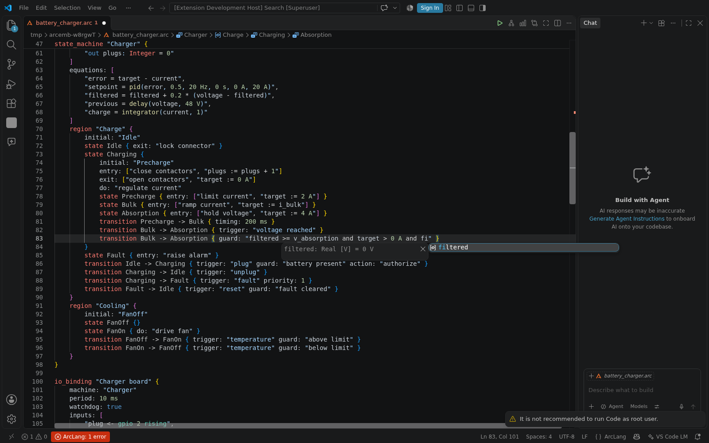

# Embedded C: from the model to any hardware

ArcLang generates the behavior of a model as C that knows no board, and
reaches the hardware through one small I/O interface. Three layers:

1. **The behavior** — `<model>.h` / `<model>.c`: the state machines of the
   model as portable C99, an `init()` / `step()` API over structures the
   caller owns. No `malloc`, no OS call, no global variable (the only
   file-scope objects are `static const` tables), no recursion, every loop
   bounded by the size of the machine. It never touches a register.
2. **The I/O interface** — `arclang_io.h`, and the bindings of the
   machine's inputs and outputs to its channels, written once in the model
   (`io_binding`), checked by the compiler and generated as glue
   (`<model>_<binding>_io.h/.c`): the only generated code that calls the I/O.
3. **The targets** — a package implements `arclang_io.h` once for a target
   (Zephyr, Linux RT, an FPGA soft core, a PLC runtime...) and says how to
   build and run on it, as data. `host` (the PC, `arclang_io_host.c`) is
   used for software in the loop; `zephyr/litex_vexriscv` runs Zephyr on a
   LiteX SoC with a VexRiscv RISC-V core, emulated in Renode, for processor
   in the loop (`arclang pil`). See [embedded-targets.md](embedded-targets.md).

A machine the model allocates to programmable logic is generated as VHDL
in fixed point instead, and called through registers: see
[embedded-fpga.md](embedded-fpga.md) (`arclang export -f vhdl`, `arclang hdl`).

```text
arclang export model.arc -f c -o build/c     # the files, for any target
arclang sil    model.arc --cc gcc --cc clang # the C against the model
arclang export model.arc -f zephyr -o app    # a Zephyr application (embedded-targets.md)
arclang pil    model.arc                     # the C on the target's processor, in Renode
```

`arclang sil` proves layers 1 and 2: it compiles the generated C on this
computer, runs every test case that `execute:`s with its input vectors,
compares the outputs with the model-level run step by step and judges the
case's `expects:` on both.

## What the generated code computes

A state machine is executed as the debugger (`arclang debug`) executes it,
by the same code (`execution::Machine`): UML and Capella semantics, nothing
invented.

- **Inputs** are the machine's *events* (the triggers of its transitions),
  its *conditions* (the guards written in prose) and its `in` *variables*. A
  guard written in prose (`"lead vehicle in range"`) is not code the
  compiler can decide: it is a boolean input the caller (or the binding)
  sets. A guard written `true` or `false` decides itself; a guard written as
  an expression over the variables (`"speed > 30 km/h"`) is computed (see
  [the action language](#the-action-language-variables-expressions-equations)).
- **Outputs** are the machine's *states* (true while active), its
  *actions* (entry, exit, do and transition actions: how many times each ran
  in the step, saturating at 255) and its *variables* (their value after the
  step). An action written in prose (`"close contactors"`) is reported, not
  executed: the integrator, or a binding, turns it into an effect. An action
  written as assignments (`"count := count + 1"`) is executed, and counted.
- **One step** (`step()`), in each machine:
  1. on the first step, the initial states are entered (their entry actions
     run in that step);
  2. the equations are evaluated, in the order written;
  3. the events of the step fire one after the other, in the order they
     arrived (see [the order of events](#the-order-of-events));
  4. the timed transitions fire when their source has been active long
     enough: `after: 200 ms` waits `ceil(200 ms / period)` steps (see
     [timers and budgets](#timers-and-budgets));
  5. the completion transitions (no trigger, no timing) fire, once;
  6. the `do:` activities of the active states run (count once), in the
     order of the states;
  7. every active state has been active one step more.

  For each trigger, the transitions it enables are chosen at the start of
  its firing (sources active, guards holding), then fired in order — inner
  source first, then lower `priority`, then declaration order — each only
  if its sources are still active. Firing exits the active states of the
  transition's scope, the last state of the scope first (so the deepest
  first; exit actions), runs the transitions' actions, then enters the
  targets, their ancestors under the scope and the initial state of every
  other region entered (entry actions, outermost first, regions in the
  order written). Orthogonal regions fire in the same step. See
  [regions and pseudo-states](#regions-and-pseudo-states) for the scope of
  a transition.

The period is `<MODEL>_PERIOD_US` (microseconds), the binding's period by
default, else 10 ms; define it at compile time for another one.

## The action language: variables, expressions, equations

A machine may declare typed variables and difference equations; a guard
can then be an expression and an action assignments. The syntax follows
SysML v2 (`in`/`out` attributes, `:=` assignment, `and`/`or`/`not`), written
in ArcLang's attribute style:

```arclang
state_machine "Charger" {
    variables: [
        "in voltage: Real [V]",                 // set by the caller every step
        "in current: Real [A]",
        "const v_absorption: Real [V] = 54.6 V",
        "target: Real [A] = 0 A",               // kept by the machine
        "error: Real [A]",
        "out setpoint: Real [A]",
        "filtered: Real [V] = 0 V",
        "out charge: Real [Ah]",
        "out plugs: Integer = 0"
    ]
    equations: [
        "error = target - current",
        "setpoint = pid(error, 0.5, 20 Hz, 0 s, 0 A, 20 A)",
        "filtered = filtered + 0.2 * (voltage - filtered)",
        "charge = integrator(current, 1)"
    ]
    ...
        state Charging {
            entry: ["close contactors", "plugs := plugs + 1"]
            state Bulk { entry: ["ramp current", "target := 16 A"] }
            transition Bulk -> Absorption { guard: "filtered >= v_absorption and target > 0 A" }
        }
}
```

**Variables**: `[in|out|const] name: Type [unit] [range lo .. hi] [format Qi.f] = initial`.
`range` and `format` give the fixed point of a machine the hardware
computes ([embedded-fpga.md](embedded-fpga.md#fixed-point)); the C and the
model ignore them (a range is not a clamp).

| Type | C type | Arithmetic |
|---|---|---|
| `Boolean` | `bool` | `and`, `or`, `not` (or `&&`, `\|\|`, `!`), `==`, `!=` |
| `Integer` | `int32_t` | saturating: `+ - * /` and negation saturate to the range of `int32_t` instead of overflowing; a division by zero gives 0 (C truncation toward zero otherwise) |
| `Real` | `double` | IEEE 754 binary64 |
| `Float` | `float` | IEEE 754 binary32 |

No fixed point is generated: the type of each variable is the one declared.
The unit (a symbol of the unit table: `V`, `km/h`, `Ah`, `m/s`...) fixes the
dimension and the unit the value is *stored* in, in the C as in the result
columns (`speed` declared `[km/h]` holds km/h). A unit with an offset (`°C`)
is refused: write temperatures in `K`. The initial value is zero (false)
when omitted. `in`: an input, in the `inputs` structure, set by the caller
every step, never assigned by the machine. `const`: never assigned. Every
other variable is kept in the `state` structure, and every variable is in
the `outputs` structure after the step.

**Expressions**: `+ - * /`, `< <= > >= == !=`, `and or not`, parentheses,
numbers with a unit (`30 km/h`, `2 A`), `true`, `false`, and the pure
functions `min(a, b)`, `max(a, b)`, `abs(a)`, `saturate(x, lo, hi)` and
`gain(x, k)` (= `x * k`). The compiler types every operation and checks the
units with the unit system of the language:

- `+`, `-`, comparisons, `min`, `max`, `saturate` take operands of one
  dimension (a plain `0` goes with any); `*` and `/` multiply and divide
  dimensions (`2 N / 1 m` is a stiffness);
- values of different units of one dimension are converted where they
  meet, the right side to the unit of the left (a number is folded at
  compile time: `speed > 30 km/h` with `speed [m/s]` compares with
  `8.333...`); a conversion of an `Integer` by a factor that is not whole
  makes it a `Real`;
- a number written in the model takes the type of the other side when it is
  a value of it (`0.5` beside a `Float` is `0.5f`); otherwise `Integer`
  meets `Float` as `Float`, anything meets `Real` as `Real`;
- an assignment converts to the target's unit and type: an `Integer` takes
  only an `Integer` (no silent truncation), a `Float` takes a `Real`
  (rounded to nearest).

The C prints the same typed tree as the model evaluates, operator for
operator, so the two compute the same bits: the integer operations are
static helpers (`arc_add_i32`...), `min`/`max`/`abs`/`saturate` are static
functions (each argument evaluated once), and the source turns
floating-point contraction off (`#pragma STDC FP_CONTRACT OFF` under Clang;
GCC does not contract in ISO C mode).

**Guards and actions as code**: a guard is an expression when it parses as
one and names a variable of the machine; it must be a `Boolean`. An action
is code when it is assignments `target := expression` (or `=`), separated by
`;`. A text that names no variable stays prose, exactly as before: old
models keep their meaning. A text that names a variable and also a name that
is none is an error (a typo), not prose. Actions run when the semantics runs
them: exit actions, then the transition's action, then entry actions; a
guard is evaluated when its trigger is processed, before any transition of
that trigger fires.

**Equations** are `target = expression`, evaluated every step in the order
written, after the initial states are entered and before the transitions;
an equation reads the values of the step so far (a variable assigned later
in the list, or by an action, reads its value of the previous step: a
sequential program, no algebraic loop). One equation per variable; an
action does not assign a variable an equation computes. In equations only,
the blocks of discrete-time data flow, each call a block with its own
state:

| Block | Output and update (step `T` = the period) |
|---|---|
| `delay(x)`, `delay(x, initial)` | the input of the previous step (the initial value on the first) |
| `integrator(x, k)` | forward Euler: `y = s; s := s + k*T*x` (unit: x·k·time) |
| `integrator(x, k, lo, hi)` | the same, output and state held in `[lo, hi]` |
| `pid(e, kp, ki, kd)` | parallel: `kp*e + I + kd*(e - e_prev)/T`, `I := I + ki*T*e`; no derivative on the first step |
| `pid(e, kp, ki, kd, lo, hi)` | the same, output held in `[lo, hi]`, clamping anti-windup (no integration further into the saturation) |

The gains carry their units: `kp*e`, `ki*e*time` and `kd*e/time` must be
of one dimension (the output's). Gain and sum are plain `*` and `+`. A block
cannot sit in the arguments of another (give the inner one its own
equation), so C's unspecified order of evaluation of arguments changes
nothing. Their arguments are converted to SI units, their output (a `Real`)
is in SI units of its dimension, converted on assignment.

The compiler's messages say what is wrong and where:

```text
state_machine 'M': guard "speed > 3 s": '>' between a speed and a time
state_machine 'M': action "n := speed": a Real assigned to Integer 'n' (an Integer holds whole numbers: declare it Real, or compute in Integers)
state_machine 'M': guard "speed > limt": 'limt' is no variable of the machine
state_machine 'M': equation "y = pid(e, 2 N / 1 m, 1 N / 1 m, 0 s)": pid(...): ki*e*time is a quantity in kg·s^-1, kp*e a force
```

In an executed case, an `in` variable takes a value from a step on
(`"100 ms: current = 1.5 A"`, in any unit of its dimension), and an
expectation reads a variable as `"Charger".setpoint`, in its unit:

```arclang
expects: ["at(100 ms, \"Charger\".target) == 2 A", "max(\"Charger\".setpoint) <= 20 A"]
```

`arclang sil` compares every variable, step by step, with the model's,
bit for bit by default (`tolerance: 0`).

## Data flow between machines

A signal-processing chain, from a measurement to the machine that uses it,
is written as machines too. No new block is needed: a machine with
equations and no state is a **data-flow block**, and an input may read
another machine's variable.

```arclang
// A data-flow block: its equations every step, no state.
state_machine "Wheel speed filter" {
    owner: "PC-SPD-FILTER"     // in the programmable logic: VHDL, fixed point
    variables: [
        "in raw: Real [km/h] range 0 km/h .. 300 km/h",
        "filtered: Real [km/h] range 0 km/h .. 300 km/h = 0 km/h",
        "out speed: Real [m/s] range 0 m/s .. 70 m/s = 0 m/s"
    ]
    equations: ["filtered = filtered + 0.25 * (raw - filtered)", "speed = saturate(filtered, 0 km/h, 250 km/h)"]
}

state_machine "Overspeed warning" {
    variables: ["in speed: Real [km/h] from \"Wheel speed filter\".speed", "const on_above: Real [km/h] = 130 km/h", ...]
    initial: "Normal"
    ...
}
```

(`examples/automotive/speed-monitor`.)

**A block** is stepped as a machine with one state of its own, `Flow`,
which is always active and is a column of the results. Everything a
machine has works the same way for a block: the C, the fixed point and the
VHDL when it is allocated to an FPGA node, SIL, PIL, HDL and the SoC. The
blocks of the action language (`delay`, `integrator`, `pid`) are the
library of the chain. A machine with neither a state nor an equation is
still refused, because there is nothing to generate.

**A wire.** `in x: ... from "Machine".variable` (or `from Id.variable`,
with the machine's id) reads that variable every step.

- **Order.** The machine that is read steps first in the model's step,
  whatever order the machines are written in, so a wire reads the value of
  the same step.
- **Conversion.** The value is converted to the input's unit and type as an
  assignment converts it: m/s into km/h above, a Real into a Float with
  rounding. An Integer takes only an Integer, and the dimensions must match.
- **Range.** An input with no `range` takes the range of what it reads, in
  its own unit. The fixed point of the machine downstream follows from the
  formats upstream: the same derivation, along the chain.
- **Loops.** A loop of wires (A reads B, B reads A) is refused. It would
  need each side to read the other in the same step. Close the loop inside
  one machine instead, whose equations may read a `delay(...)`.

**In the C**, a machine that reads others steps on a copy of its inputs,
with the wired inputs set from the other machines' outputs. Those outputs
are already written in the step, and the C prints the same typed
conversion the model evaluates:

```c
speed_monitor_overspeed_warning_inputs wired = inputs->overspeed_warning;
wired.v_speed = (outputs->wheel_speed_filter.v_speed * 3.5999999999999996); /* from state_machine "Wheel speed filter", speed */
```

**In a case**, the machine's own inputs are written as before. An input of
a block upstream is named with its machine:
`"0 s: \"Wheel speed filter\".raw = 140 km/h"`. An input that a wire sets
is not set by a case. The expectations read any machine.

**In the stages.** SIL and PIL run the whole model's step, the chain
included: the C reproduces the model to 0 difference. HDL and the SoC run
a block alone, in fixed point. Its wired inputs replay the values the model
gave them, as a plant's loop is replayed. The block is then bit-exact with
its fixed-point C on the same inputs, and the quantisation is measured on
them. On the speed monitor, the filter in VHDL is bit-exact with its
fixed-point C in GHDL and in the simulated SoC. It synthesises for the
ECP5 in 740 LUT4 and 4 DSP, with an Fmax of 54.9 MHz for a 25 MHz clock.
The warning reads it in C, on the processor.

**On the target**, the task of an `io_binding` steps the blocks its machine
reads, each after the blocks it reads, before the machine itself. Each
such block runs in one task. A wire from a machine that another
`io_binding` runs as a task of its own is refused: it would cross two
tasks, and the rate transition that needs is not generated.

Not done yet:

- a fixed-point chain kept in words from one block to the next in the
  logic (each block quantises its inputs from the values);
- rate transitions between tasks;
- delayed wires (a loop through a unit delay between two machines);
- a case of a software machine run in the SoC while the block it reads
  computes in the logic. The SoC stage runs the cases of the block; PIL
  runs the whole chain in C on the processor.

## Regions and pseudo-states

A state may hold several orthogonal regions, written as `region` blocks
inside it (as the machine itself may), each with its initial state:

```arclang
state Active {
    region "Motion" {
        initial: "Stopped"
        state Stopped {}
        state Moving { initial: "Up" state Up {} state Down {} }
        state Resume { kind: "deep_history" }
        state Decide { kind: "choice" }
        transition Stopped -> Decide { trigger: "auto" }
        transition Decide -> Up { guard: "position < 50" }
        transition Decide -> Down { guard: "else" }
    }
    region "Safety" {
        initial: "Watching"
        state Watching {}
        state Pinched {}
        state Monitor { kind: "shallow_history" }
        transition Watching -> Pinched { trigger: "obstacle" }
    }
    transition Pinched -> Stopped { trigger: "release" }   // across the regions
}
```

Pseudo-states are written as the Capella import writes them: a state with
a `kind:` (Capella's `ChoicePseudoState`, `ForkPseudoState`...). They
are never active, so no output reports them. The executor, the C and the
SIL run them alike (`examples/automotive/power-window/power_window.arc`):

| `kind:` | Semantics (UML / Capella) |
|---|---|
| `junction` | static: its branches are chosen before the transition fires, with the values of that moment; the transition is enabled only when a branch holds |
| `choice` | dynamic: its branch is chosen when it is reached, after the exits and actions before it (it sees what they assigned); the transition is enabled only when a branch holds then; if the actions made none hold, the first branch |
| `fork` | one transition to several states of orthogonal regions; the regions not named enter their initial state |
| `join` | fires when every source is active and every incoming transition's guard holds, on their common trigger; all their actions run, then the outgoing one's |
| `shallow_history` | entering it enters the state its region was in when its owner was last exited (by its initial states); else its default transition, else the region's initial state |
| `deep_history` | the same with every state that was active in the region, down to the leaves |
| `entry_point`, `exit_point` | pass through: the transition goes on along their outgoing transition |
| `terminate` | the machine stops: nothing is active, no exit action runs, no transition fires any more |

Branches of a junction or a choice are tried in `priority` then
declaration order; a branch guarded `else` is tried last and always holds.
A `final` state is a state (it has no outgoing transition).

The scope of a transition (what it exits and what it re-enters) is the
region that holds both ends, as UML defines it:

- in one region of their common ancestor: the active state of that region
  is exited; the target is entered with its ancestors under it;
- a target inside its source (local): the source stays active, only the
  region holding the target changes;
- a source inside its target, or a state to itself: the target is exited
  and entered again, by its initial states;
- between orthogonal regions: the state holding both regions is exited and
  entered again (the whole machine for top-level regions), the target in
  its region, the other regions by their initial state.

A pseudo-state used against its meaning is refused with the reason, and no
C is generated for the machine: a join whose incoming transitions have
different triggers or with more than one outgoing transition, a fork whose
targets share a region, a junction or a choice without an outgoing
transition, transitions that go round through pseudo-states.

The diagram of a machine (`msm:<machine>`) draws what the machine runs: each
region as a dashed frame with its name and where it starts, the start of a
composite state inside it, a choice as a diamond, a fork or a join as a bar,
a junction as a dot, a history as a ring marked H (H* when deep), an entry
or an exit point as a ring (crossed for the exit), a terminate as a cross,
and a timed transition as `after 200 ms` on its line. In the VS Code
workbench the palette of that diagram has a tool for each (Region, Choice,
Junction, Fork, Join, History, Deep history, Entry point, Exit point,
Terminate): a state, a mode or a pseudo-state is declared in the selected
state or region, else in the machine.

In the C, a history is a field of the machine's state (`hist_<n>` for a
shallow one, `deep_<n>[]` for a deep one), kept when its owner is exited;
exits run over a range of the state table, last state first; every other
entry and exit is a list computed once from the executor.

Capella has every one of these pseudo-states but the junction: a junction
is exported as a Capella choice (its branches are then chosen when
reached). SysML v2 export writes the states of every region of a state
in one region, as it does for the machine's top-level regions.

## Timers and budgets

A time on a transition is one of two things, said explicitly:

```arclang
transition Arming -> Armed { after: 30 ms }                        // a timer: it fires
transition Done -> Idle { trigger: "after 20 ms" }                 // the same (SysML v2 `accept after`)
transition Armed -> Done { trigger: "confirm" budget: 50 ms }      // a budget: it is watched
```

- **A timer** (`after:`, or `trigger: "after <time>"`) is the trigger of the
  transition: it fires when its source has been active `ceil(time /
  period)` steps (guards holding). A transition has one trigger: an event
  and `after:` together are refused.
- **A budget** (`budget:`) is how long the source may stay active before
  the transition fires. It is never a timer: nothing fires because of it.
  It is watched: the machine reports, for each budget, an output true in
  every step its source has been active longer than `ceil(budget /
  period)` steps (in the C, `bool bud_<transition>`; in a case,
  `"Machine".budget.<transition>`, `Armed -> Done` written `Armed_Done`), so
  an expectation can require `max("W".budget.Armed_Done) == 0`.
- `timing:` keeps its meaning: without a trigger a timer, beside a trigger
  a budget (now generated and watched).

## The API

For a model `Battery Charger` with a machine `Charger`:

```c
#include "battery_charger.h"

battery_charger_state   state;    /* the machines' active states and timers */
battery_charger_inputs  inputs;   /* inputs.charger.queue, .cond_battery_present ... */
battery_charger_outputs outputs;  /* outputs.charger.st_charging, .act_close_contactors ... */

battery_charger_init(&state);
for (;;) {
    inputs.charger.queued = 0U;   /* the events of this step, in arrival order: */
    (void)battery_charger_charger_post(&inputs.charger, BATTERY_CHARGER_CHARGER_EV_PLUG);
    inputs.charger.cond_battery_present = true;
    battery_charger_step(&state, &inputs, &outputs);
    /* read the outputs */
}
```

Every field carries, in a comment, the text it comes from (`/* event
"plug" ... */`). The names: `<MODEL>_<MACHINE>_EV_<EVENT>` (an event's
code), `cond_<condition>`, `v_<variable>`, `st_<state path>`,
`act_<action>`, in snake case.

## The order of events

The events of a machine reach a step through a queue: `queue[]` and
`queued` in its inputs, filled by `<model>_<machine>_post()` in the order the
events arrived (false, and the event dropped, when `<MODEL>_<MACHINE>_QUEUE_SIZE`
events, 16 by default, are already queued). One step processes them in that
order, each as a run to completion: its transitions are chosen (sources
active, guards holding) and fired before the next event is looked at. An
event posted twice fires twice. Then come the timed transitions and the
completion transitions, as before. The caller empties the queue
(`queued = 0`) before posting the events of the next step.

In an executed case, an event may arrive at any time (`"13 ms: plug"`): the
first step at or after it takes it, and the events of one step are ordered
by their time, then as the inputs list them. A condition or a variable
changes on the step grid only.

Through an `io_binding`, the glue posts the events in the order it reads
them, which is all the I/O tells of their order within a period: the edges
of the gpio pins (by pin), then the CAN frames (by identifier), then the
UART bytes (by port, in the order they were received: two bytes are two
events). A case whose order of events in a step the I/O cannot give (a UART
byte before a gpio edge of the same step, an edge twice in a step) is in
error and says so.

## The I/O interface

`arclang_io.h` holds what a controller needs and no more:

| Function | Why |
|---|---|
| `arclang_io_init` | bring the I/O up before the first cycle |
| `arclang_io_gpio_read/write` | discrete signals: switches, relays, lamps, edges as events |
| `arclang_io_adc_read` | analog sensors, compared with raw thresholds as conditions |
| `arclang_io_dac_write` | analog setpoints |
| `arclang_io_pwm_write` | actuators driven by a duty cycle (fans, valves, motors) |
| `arclang_io_can_receive/send` | the vehicle and industrial bus: frames as events, their first byte as a condition |
| `arclang_io_uart_read/write` | serial links: a byte as an event or as an effect |
| `arclang_io_clock_wait_period` | the step rate: the only call that blocks |
| `arclang_io_watchdog_kick` | the target resets when the cycle stops |

Every function returns `ARCLANG_IO_OK` or an error (`ERR_CHANNEL`,
`ERR_DEVICE`, `ERR_FULL`). Values are raw: converter counts, per mille,
bytes; the model compares them, the target scales them.

## Binding a machine to the channels

```arclang
io_binding "Charger board" {
    machine: "Charger"
    period: 10 ms
    watchdog: true
    inputs: [
        "plug <- gpio 2 rising",          // an event: an edge
        "unplug <- gpio 2 falling",
        "battery present <- gpio 3",      // a condition: a level
        "voltage reached <- can 0x210",   // an event: a frame received
        "fault <- uart 0 0x46",           // an event: a byte received
        "above limit <- adc 1 > 3000",    // a condition: a raw threshold
        "temperature <- can 0x211"
    ]
    outputs: [
        "Charging -> gpio 20",            // a state: high while active
        "FanOn -> pwm 0 600",             // 600 per mille while active
        "close contactors -> uart 1 0x43" // an action: a byte each step it runs
    ]
}
```

| Input channel | Binds | Value |
|---|---|---|
| `gpio N rising` / `falling` | an event | the edge since the last cycle (edges count from a low level) |
| `can ID` | an event | a frame with this identifier received since the last cycle |
| `uart N BYTE` | an event | this byte among those received in the period (at most 16 read) |
| `gpio N` | a condition | the level |
| `adc N > RAW` / `< RAW` | a condition | the raw value against the threshold |
| `can ID` | a condition | the first byte of the last frame not zero (held between frames) |

| Output channel | Writes |
|---|---|
| `gpio N` | high while the value is not zero |
| `pwm N PERMILLE` | the duty while not zero, else 0 |
| `dac N RAW` | the raw value while not zero, else 0 |
| `can ID` | a frame every period, its first byte the value |
| `uart N BYTE` | the byte each step the value is not zero |

The compiler refuses, with the reason: an input or output that names no
event, condition, state or action of the machine (it lists those there
are); an event bound to a level or an analog value; a condition bound to an
edge or a UART byte; an input bound twice; a channel written twice; a pin
both read and written; an `adc` threshold that can never hold; a CAN
identifier above 29 bits, a byte above 255, a duty above 1000; a period that
is not a whole number of microseconds; an unknown machine. An event or a
condition left unbound is a warning: on the target it never occurs, never
holds.

`target: "zephyr/litex_vexriscv"` names the target package the binding is
deployed on (`host` by default): the compiler also refuses a channel the
target does not have, or a number beyond its range (see
[embedded-targets.md](embedded-targets.md#choosing-a-target)).

The glue (`<model>_<binding>_io.c`) gives:

```c
void              <b>_glue_init(<b>_glue *glue);
arclang_io_status <b>_read (<b>_glue *glue, <model>_inputs *inputs);
arclang_io_status <b>_write(const <model>_outputs *outputs);
arclang_io_status <b>_cycle(<b>_glue *glue, <model>_state *state,
                            <model>_inputs *inputs, <model>_outputs *outputs);
```

`cycle` reads; if a read failed it returns the error without stepping (the
application decides what a failed read means); it steps, writes, and kicks
the watchdog only when everything succeeded. A channel in error posts no
event and leaves its conditions false; an event the queue has no room for
makes the read fail with `ARCLANG_IO_ERR_FULL`. A main loop on a target:

```c
arclang_io_init();
battery_charger_init(&state);
battery_charger_charger_board_glue_init(&glue);
for (;;) {
    if (battery_charger_charger_board_cycle(&glue, &state, &inputs, &outputs) != ARCLANG_IO_OK) {
        /* the application's reaction: count, degrade, stop kicking... */
    }
    (void)arclang_io_clock_wait_period(BATTERY_CHARGER_CHARGER_BOARD_PERIOD_US);
}
```

The glue refuses to compile (`#error`) when the behavior was compiled for
another period than the binding's.

## Tasks and scheduling

A processor runs several machines: one `io_binding` each, on the same
`target:`, each with its `period:` and, if wanted, its `priority:` (1 the
highest, up to 32). The exported application (`arclang export -f zephyr`)
then runs **one task per binding** (`src/tasks.c`): a Zephyr thread with
its own periodic clock (`arclang_io_task_wait_period`), its glue and its
machine's step (`<model>_<machine>_step`), at its priority. Without
`priority:` the priorities follow the periods, the shortest the highest
(rate monotonic). The machines share the model's state and I/O structures
but each task touches its own machine's members only; the watchdog is
kicked by the bindings that ask for it. `--binding` still exports one
binding alone (`src/main.c`); `arclang pil` runs the cases one binding at
a time, as before.

```arc
io_binding "Wiper task" { machine: "Wiper" target: "zephyr/litex_vexriscv" period: 20 ms ... }
io_binding "Light task" { machine: "Interior light" target: "zephyr/litex_vexriscv" period: 100 ms ... }
```

`arclang schedule model.arc` says whether every task meets its period,
from the step times **measured** on the target (`arclang partition`:
the longest a step took of the target's virtual time) — never a guess;
`--wcet "Machine=25.5"` gives one instead:

```text
Schedule body_controller.arc — 2 task(s) on zephyr/litex_vexriscv, fixed priorities, preemptive (response-time analysis)
  task "Wiper task" (Wiper)  period 20.00 ms  priority 1  step ≤ 9.0 us · response ≤ 9.0 us · meets its period (0.0 % of it) [measured under load (arclang schedule --prove)]
  task "Light task" (Interior light)  period 100.00 ms  priority 2  step ≤ 5.0 us · response ≤ 14.0 us · meets its period (0.0 % of it) [measured under load (arclang schedule --prove)]
  utilisation 0.1 % (rate-monotonic bound 82.8 %) · every task meets its period
  note: priorities by the period (rate monotonic): the shortest period the highest; write priority: in a binding to choose
```

The analysis is the response-time analysis of fixed-priority preemptive
scheduling (Joseph and Pandya): a task's worst response is its own time
plus the interference of every task of higher (or equal) priority over
that response, iterated to a fixed point; the task meets its period when
the response fits in it. The set's utilisation is compared with Liu and
Layland's bound for information: the periods are met by the response
times, not by the bound. A task whose step time is unknown leaves the
schedule unproved (the command fails and says what to run). The table
kind `schedule` lays the same out per binding (`arclang table --kind
schedule`), the measurement stale when the generated C changed since.

**Proved on the target.** `arclang schedule model.arc --prove` runs every
task of the target together first: the application as the firmware runs it
(one thread per binding, `src/pil_tasks.c` reporting each cycle), in the
target's emulator (Renode for the LiteX SoC; the command relays itself to
the SoC image when the host has no Zephyr), each binding's channels driven
by a case of its machine on the binding's own period grid, all at once,
for `--cycles` cycles of the longest period. Per task it says whether every
cycle came, one a period (within a twentieth of it), none failed — the
period kept under the others' load — and the longest a cycle took, which
is then the step time the analysis runs on (`measured under load`):

```text
Tasks on zephyr/litex_vexriscv together, in Renode (5 cycle(s) of the longest period):
  ✓ task "Wiper task" (Wiper) every 20000 us at priority 1: 30 cycles, one every 20000 us (19993 to 20007); a cycle took at most 9.0 us, the channels quiet
  ✓ task "Light task" (Interior light) every 100000 us at priority 2: 6 cycles, one every 100000 us (100000 to 100001); a cycle took at most 5.0 us, the channels of TC-BC-002 played
  kept in examples/automotive/body-controller/.arclang/sim-cache/schedule.json
```

A task's channels are played from the first executed case of its machine
whose stimuli all go through the binding's channels (TC-BC-002 for the
light; the wiper's case sets a variable, which no channel can, so its
channels stay quiet: its cycles still run, read and write). The bench
runs a period past the horizon, so a cycle or two more than the count
asked may come.

The runs are kept beside the model (`schedule.json`), keyed by the
application's files and the plan; the compiler reads them back for the
table and the analysis, stale when the generated code or the cases
changed. A task that slips a period fails the command and names it.

What this proves and what it does not: the analysis covers the tasks'
own steps, preempted by each other, and the proof sees them with the
kernel, the drivers and the console between them on the target; neither
counts interrupts the model does not know. The tasks do not exchange
events yet. A machine reads the channels, and the blocks its own task
steps before it ("Data flow between machines"), not another task's
machine.

## Test cases executed at fixed step

```arclang
test_case "TC-CHG-001" {
    verifies: ["SYS-CHG-001", "SYS-CHG-002"]
    execute: {
        machine: "Charger"
        step: 10 ms
        stop_time: 600 ms
        inputs: ["0 s: battery present", "20 ms: plug", "400 ms: voltage reached", "500 ms: unplug"]
    }
    expects: [
        "SYS-CHG-001: at(210 ms, \"Charger\".Charging.Precharge) == 1",
        "SYS-CHG-002: final(\"Charger\".Idle) == 1",
        "at(20 ms, \"Charger\".action.close_contactors) == 1"
    ]
}
```

- `inputs`: `"<time>: <event>"` — the event arrives at that time, taken by
  the first step at or after it, in order of arrival; `"<time>:
  <condition>"`, `"<condition> = false"` — it holds, or not, from that step
  on (conditions start false); `"<time>: <variable> = <value>"` — an `in`
  variable. A condition's or a variable's time is on the step grid.
- `expects`: the comparisons of simulated cases (`min`, `max`, `final`,
  `initial`, `mean`, `at(t, ...)`), over the run's variables: a state reads
  `"Machine".State` (`"Machine".Parent.Child` for a nested one; 1 while
  active), an action `"Machine".action.<its text, other characters _>`.
- `binding: "Charger board"`: the run goes through the I/O. The vectors
  become pin levels, converter values, CAN frames and UART bytes on the host
  board; the glue reads them; what the glue writes on the bound output
  channels is compared too. When the I/O cannot produce the vectors (two
  rising edges of one pin in consecutive steps; a value no threshold
  gives), the run says so and is in error.
- `tolerance`: how far a C value may be from the model's (default 0: the
  outputs are discrete and must be equal).

Compiling the model runs each case on the model and warns of a failing one
(`verification: test_case 'X' fails on the model: ...`); it also refuses a
case naming a machine, an input, a binding or a variable that does not exist.

## Software in the loop

```text
$ arclang sil examples/energy/battery-charger/battery_charger.arc --cc gcc --cc clang

SIL examples/energy/battery-charger/battery_charger.arc — gcc (gcc (Debian 12.2.0-14+deb12u1) 12.2.0)

  ✓ pass  TC-CHG-001
    verifies SYS-CHG-001, SYS-CHG-002 · machine Charger
    model: pass · C: pass · the C reproduces the model
    back to back: 61 steps × 34 outputs, largest difference 0 (tolerance 0)
    ok   SYS-CHG-001: at(210 ms, "Charger".Charging.Precharge) == 1   model 1 · C 1
    ok   SYS-CHG-001: at(230 ms, "Charger".Charging.Bulk) == 1   model 1 · C 1
    ok   at(400 ms, "Charger".Charging.Absorption) == 1   model 1 · C 1
    ok   SYS-CHG-002: final("Charger".Idle) == 1   model 1 · C 1
    ok   SYS-CHG-002: at(500 ms, "Charger".action.open_contactors) == 1   model 1 · C 1
    ok   at(20 ms, "Charger".action.close_contactors) == 1   model 1 · C 1
    ok   max("Charger".action.regulate_current) == 1   model 1 · C 1

  ✓ pass  TC-CHG-002
    verifies SYS-CHG-003 · machine Charger · through io_binding Charger board
    model: pass · C: pass · the C reproduces the model
    back to back: 41 steps × 40 outputs, largest difference 0 (tolerance 0)
    ok   at(60 ms, "Charger".FanOn) == 1   model 1 · C 1
    ok   at(100 ms, "Charger".Fault) == 1   model 1 · C 1
    ok   at(160 ms, "Charger".FanOff) == 1   model 1 · C 1
    ...

  3 verdict(s) cached in examples/energy/battery-charger/.arclang/sim-cache
```

Each case is compiled with `-std=c99 -Wall -Wextra -Werror -pedantic`, run
with the vectors, and judged:

- `pass`: the C reproduces the model (every output equal at every step,
  within `tolerance`, and every expectation judged alike) and every
  expectation holds;
- `fail`: an expectation fails (on the C as on the model: the model is
  wrong, or the requirement), or the C departs from the model (the first
  departing value is shown);
- `error`: the C did not compile or run, or the vectors cannot go through
  the I/O.

A case that verifies several requirements fails each of them on its own
expectations while the C reproduces the model. When the C departs from the
model, every requirement of the case fails, whatever its expectations say:
what was checked is not what was built. A case run at several stages (the
model, the C, the co-simulation, the HDL) keeps for each requirement the
worst of what the stages say; a later stage that passes does not clear an
earlier failure.

`--test` runs one case, `--keep DIR` keeps the generated files, the
harnesses and the binaries, `--json` prints the outcomes. The command fails
when a case does not pass.

The verdict of each case run is kept in `.arclang/sim-cache/` beside the
model, as `arclang verify` keeps simulation verdicts, keyed by a hash of
every generated file, the case's `execute:`, its expectations and, for a
case that closes its loop on a plant, the content of the plant's files (and
the model's own Modelica export when the plant reads it) (over all
the compilers of the run: an error with one is an error, a failure a
failure). `check`, `gate`, the tables and the documents read it: a fresh
verdict is the case's verdict (by requirement when its expectations name
requirements), with its values as evidence; a case never run in SIL, or
whose C, case or plant changed since (stale, with a warning), is
inconclusive and says what to run. A plant file that is gone makes the
verdict stale, not an error.

The model's run and the C's are compared value by value: a value that is
not a number (`NaN`) in either agrees with nothing, and the case fails as
one whose C departs from the model.

## The plant in the loop

A list of inputs says what the machine sees; it cannot say whether the
machine does the right thing to what it controls. A case closes the loop
on a **plant**, a model of the physics, with `plant:` inside `execute:`:

```arc
test_case "TC-CHG-HIL" {
    verifies: ["SYS-CHG-004", "SYS-CHG-005"]
    execute: {
        machine: "Charger"
        step: 10 ms
        stop_time: 1.5 s
        inputs: ["0 s: battery present", "20 ms: plug"]
        plant: {
            model: "ChargerPhysics.Battery"
            sources: ["physics/ChargerPhysics.mo"]
            inputs: ["i_set <- setpoint"]
            outputs: ["voltage <- v_batt", "current <- i_batt"]
        }
    }
    expects: ["SYS-CHG-005: at(1 s, \"Charger\".Charging.Absorption) == 1", ...]
}
```

- `model:` a Modelica model, its `sources:` beside the `.arc` (as
  `simulate:` names them); **or** `fmu:` a co-simulation FMU as a file,
  FMI 2.0 or FMI 3.0 (from Simulink, Dymola, Amesim, OpenModelica, the
  Reference FMUs, any exporter): see "An FMU from another tool" below.
- `inputs:` the plant's `input` variables, each driven by a variable the
  machine computes (`out` or internal); `outputs:` the machine's `in`
  variables, each read from a variable of the plant. Values pass in SI,
  as the machine stores them scaled to its units. The `in` variables not
  wired stay driven by `inputs:` of the case.
- `tolerance:` the solver's (CVODE), `1e-6` by default.

At each step the machine reads the plant, steps, and the plant advances
one period with the machine's outputs held (a zero-order hold, as a DAC
holds). The first step reads the plant initialised on the machine's
initial outputs. Nothing is real time: plant and device advance in lock
step, and a run is reproducible to the bit.

The loop runs around every implementation the same way:

| Stage | How |
|---|---|
| the model | the reference interpreter in the loop: the reference of the others |
| `arclang sil` | the C harness fed a step at a time, the plant on what it answers |
| `arclang hdl` | the VHDL replays the model's loop; the fixed point is measured against the model on those same inputs |
| `arclang pil` | the processor replays the model's loop (its C matches the model within tolerance) |
| `arclang soc` | the simulated SoC, or the board through its port, in the loop: a line a step; bit-exact with the fixed-point C run in the loop too |
| `arclang hil` | the generated C on a board (an Arduino, any microcontroller with a serial port) through the same harness: not in the loop yet, the vectors sent, the rows read back, judged as SIL |

### An FMU from another tool

The FMU is stepped as it is. A small stepper, compiled where the FMU
runs, reads the description:

- `fmiVersion`, 2.0 or 3.0;
- the co-simulation `modelIdentifier`, which names the library;
- the variables named in `inputs:` and `outputs:`, which must be real
  (`Real` in 2.0, `Float64` in 3.0).

It loads the binary built for the platform it runs on. The 3.0 name of the
platform is tried first, then the 2.0 one: `aarch64-darwin` then
`darwin64`, and `x86_64-linux` or `aarch64-linux` then `linux64`. When
the FMU has a binary for this computer, the computer's C compiler steps it.
Otherwise the OpenModelica image steps it, which works for a Linux binary.

Units come from the description: a variable's own `unit`, or the unit of
its `declaredType`.

Between two instants, an input can go along a slope. In the plant loop it
does not: the loop holds the machine's outputs, so the slopes are zero. A
live twin does use slopes. FMI 2.0 takes them through
`fmi2SetRealInputDerivatives`. FMI 3.0 has no such call: the slope is set
on the input the FMU declares as the derivative of the input
(`derivative="<value reference>"`), and an input without one is held over
the step.

What is not taken:

- a Model Exchange-only FMU (no `<CoSimulation>`);
- a source-only FMU (no binary);
- variables other than reals;
- FMI 3.0 clocks, event mode and early return. The stepper instantiates
  without them, so a step always ends where it was asked to.

`tests/embedded_plant.rs` builds the same room as an FMI 2.0 FMU and as an
FMI 3.0 FMU, both with the identifier `Room`, from
`tests/fixtures/fmu/room.c`. In both versions the room follows a ramp of
its input exactly, and closes the heater's loop as the same room written
in Rust does. The Modelica Reference FMUs (VanDerPol, BouncingBall,
Feedthrough) were also stepped in both versions, in the OpenModelica
image. VanDerPol gives the same values in 2.0 and in 3.0.

A plant written in Modelica is built once as an FMU by OpenModelica
(local `omc` or its Docker image) and kept under `.arclang/plant/` beside
the model, keyed by the model, its sources and the wires; a stage that runs
in a Docker image (docs/realization.md) steps the FMU the host built. The
stepper is `twin_stepper.c`, the twin's (docs/digital-twin.md): FMI 2.0
co-simulation, one `fmi2DoStep` a period. A given FMU is stepped by this
computer's C compiler when it holds a binary for this platform, else where
OpenModelica runs.

The verdict says `in the loop with the plant <model> (FMI 2.0
co-simulation)` in its tools, and is cached and read as any other: the
realization ladder climbs a case with a plant like any case. A case with a
plant does not go through an `io_binding` yet: its channels are proved by
the cases without one.

On the charger (`examples/energy/battery-charger`, `physics/ChargerPhysics.mo`:
the power stage as a first-order lag, the pack's voltage as its open-circuit
voltage plus the drop on its resistance), TC-CHG-HIL is the only case that
can prove SYS-CHG-005: precharge at 2 A, bulk at 16 A lifts the terminals
past 54.6 V, the filtered voltage follows, absorption at 4 A.

## An FMU of the behavior

```text
CC=gcc arclang export model.arc -f fmu -o build/fmu
python3 tools/embedded/fmu_check.py build/fmu/battery_charger.fmu build/fmu/cases/TC-CHG-003
```

`-f fmu` wraps the generated C as an **FMI 2.0 co-simulation FMU**
(`<model>.fmu`): `modelDescription.xml`, the sources (the behavior,
`fmu.c` with the `fmi2*` functions over `init()` / `step()`, and
`arclang_fmi2.h`, the FMI 2.0 types and signatures) and, when `$CC` (else
`cc`) compiles them, the shared library of this computer under
`binaries/linux64` (or `darwin64`, `win64`; fmpy reads an aarch64 Linux
library from `linux64` too). Without a compiler it is a source FMU.

- Inputs: the events (Boolean: an event is posted in the first step of a
  communication step while its input is true; two events of one step are
  posted in the machine's order, as an FMU input carries no order), the
  conditions (Boolean) and the `in` variables (Real, Integer, Boolean; a
  `Float` is a Real). Outputs: the states (Boolean), the actions (Integer,
  the times run in the last step), the other variables, the budgets.
- `fmi2DoStep(t, h)` runs the steps of the behavior whose time falls in
  `[t, t + h)` (step k at k × period) with the inputs set at `t`: any
  communication step works; the outputs are those of the last step run.
- The wrapper allocates its instance through the importer's callbacks, as
  FMI requires; the behavior still allocates nothing. No FMU state
  get/set, no directional derivatives (they answer `fmi2Error`).

The export also writes, for each executed case the FMU can give, its
inputs (`cases/<id>.inputs.csv`, one row per step) and the model-level
reference at the end of each step (`cases/<id>.reference.csv`).
`tools/embedded/fmu_check.py` loads the FMU with fmpy's FMI 2.0
co-simulation interface, plays the inputs, and compares every output at
every step: on the charger (3 cases, 32 outputs, with the PID, the filter
and the charge integrator), the power window (2 cases) and the cruise
control (2 cases), the largest difference is 0. `fmpy validate` finds no
problem in the FMU.

Not done: an FMI 3.0 export (an FMU from another tool is taken in 3.0 as
in 2.0, see "An FMU from another tool"; no consumer asks for a 3.0 export
yet), and a run in OpenModelica's `importFMU`, which takes only FMI 2.0 Model
Exchange FMUs. The FMU runs in OMSimulator, OpenModelica's FMI and SSP
master, with its plant and its inputs: `arclang cosim`, see
[cosimulation.md](cosimulation.md). fmpy's
`simulate_fmu` samples discrete inputs a step late at the breakpoints of an
input table, which is why the check drives `fmi2DoStep` itself.

## In VS Code

The extension's grammar knows `io_binding` and `region`, and colours the
action language inside the strings of `guard:`, `action:`, `entry:`,
`exit:`, `do:`, `equations:` and `variables:` (operators, `and`/`or`/`not`,
functions and blocks, types, units, numbers; an action in prose is coloured
as words, not as a string) and the channels of a binding's `inputs:` and
`outputs:`. The language server completes the machine's variables, the
operators' words and the functions inside a guard or an action, the blocks
inside an equation, the directions and the types inside `variables:`, the
keys inside `execute: { }`, and `io_binding` at the top level
(`editors/vscode/test/e2e/vscode_embedded_test.js` checks it in the real VS
Code).



## MISRA C 2012

`tools/embedded/misra.sh` (run in the embedded image: `tools/embedded/run.sh
tools/embedded/misra.sh`) exports the C of every example that has a state
machine and runs cppcheck 2.10's MISRA C 2012 addon on it (`--addon=misra
--std=c99 --enable=style`; the host implementation of `arclang_io.h`, used
only for SIL, is not checked). `tests/embedded_c.rs` keeps four examples at
the deviations below; that test and the FMU one need the image's tools, so
they are `#[ignore]`d on a bare host and run there: `tools/embedded/run.sh
cargo test --test embedded_c -- --include-ignored` (the CI job "Embedded
chain" does the same).

Over the 18 examples:

| Rule | Before | After | What changed |
|---|---|---|---|
| 2.5 (advisory) unused macro | 42 | 26 | `NO_STATE` only where a history uses it; the rest is a deviation |
| 5.2 identifiers distinct (63 chars) | 5 | 0 | identifiers bounded: a long one keeps its start and ends with a hash |
| 5.4 macro identifiers distinct | 25 | 0 | the same, for the event codes |
| 8.7 (advisory) external linkage used in one unit | 4 | 4 | deviation |
| 8.9 (advisory) object at block scope | 2 | 0 | the history tables inside the one function that reads them |
| 9.3 partially initialised array | 6 | 0 | CAN buffers initialised element by element |
| 10.3 assignment of another essential type | 2 | 0 | `INT32_MIN`/`INT32_MAX` cast to `int32_t` |
| 10.8 composite expression cast | 15 | 0 | no cast of the tick count of timers and budgets |
| 12.1 implicit precedence | 3 | 0 | the integrator and PID arithmetic parenthesised (same evaluation order) |
| 15.5 single point of exit | 5 | 0 | `run()` of a terminating machine and the glue's `cycle()` |
| **Total** | **109** | **30** | |

The deviations that remain, with their reason:

- **Rule 2.5** (advisory), `<MODEL>_<MACHINE>_STATE_COUNT` and the
  binding's `<BINDING>_PERIOD_US`: they are the API of the generated header
  for the integrator (sizing a log of the states; the period of the main
  loop); the generated code itself has no use for them.
- **Rule 8.7** (advisory), `<binding>_read()` and `<binding>_write()`: the
  glue offers them to an application that reads and writes around its own
  step (instead of `<binding>_cycle()`), so they keep external linkage
  although the glue calls them only from its own unit.

The addon checks the rules it implements without their texts; rules it
does not decide (the directives, and the rules needing a whole program or
a human reading) are not covered by these numbers.

## What is not generated yet

Said plainly:

- **No fixed point in this C, no continuous time.** Variables are `bool`,
  `int32_t`, `float` or `double` as declared (the fixed-point C is the
  reference of the hardware: [embedded-fpga.md](embedded-fpga.md)); the data flow is discrete
  (difference equations and the blocks above, at the step period).
  Continuous dynamics stay in the Modelica export. Variables are not bound
  to I/O channels yet (an `io_binding` binds events, conditions, states and
  actions): a case that sets a variable runs without `binding:`.
- **No functional chains, scenarios or functions** are generated as code:
  the debugger executes them, the generator does not.
- **Deferred events and change events** are not in the executor, so not in
  the C. A completion transition leaving a composite state does not wait
  for its regions to reach their final states: it fires as soon as its
  source is active.
- **Targets**: the host and one Zephyr target, `zephyr/litex_vexriscv`,
  run in emulation (Renode); no bitstream, no board in this lot. See
  [embedded-targets.md](embedded-targets.md#limits-said-plainly).
- **No certification claim.** The generated code is written to be simple
  to review (static tables, bounded loops, no recursion, no dynamic memory),
  is compiled warning-free under the strict flags above and is checked with
  cppcheck's MISRA C 2012 addon (below); nothing here is qualified for
  DO-178C or ISO 26262, and an addon run is not a MISRA compliance claim.
