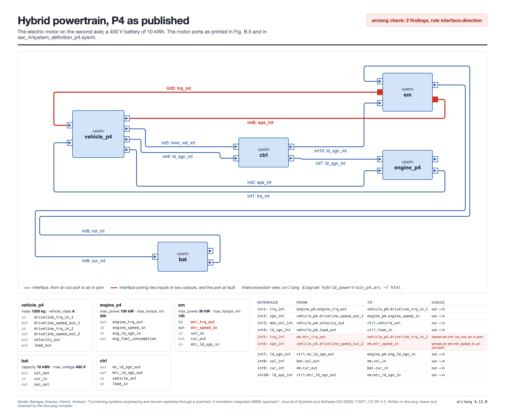

# Hybrid powertrain, P1 and P4

The case study of Banagar, Kramsu, Könnö and Andwari, *Connecting systems
engineering and domain expertise through a toolchain: A simulation-integrated
MBSE approach*, Journal of Systems and Software 232 (2026) 112671,
[doi:10.1016/j.jss.2025.112671](https://doi.org/10.1016/j.jss.2025.112671),
open access under CC BY 4.0. Their SysML v2 models (appendix B, and
[`sec_4/`](https://github.com/mvd-oulu/Standard-System-Interface/tree/SSI_v1.0.0/sec_4)
of their MIT-licensed repository) written in ArcLang: five subsystems, their
ports and the interfaces between them, with the units their attributes leave
implicit.

| File | What |
|---|---|
| `hybrid_powertrain_p1.arc` | P1: the motor on the crankshaft, a 48 V battery of 5 kWh |
| `hybrid_powertrain_p4.arc` | P4: the motor on the second axle, a 400 V battery of 10 kWh, as published |
| `hybrid_powertrain_p4_fixed.arc` | P4 with the motor's mechanical ports corrected |

## What the compiler finds

In the published P4 model, the electric motor's mechanical ports are the
reverse of the P1 motor's: `port mtr_trq_out:~mech_trq;` and `port
mtr_speed_in:mech_spe;`, where P1 has `mtr_trq_out:mech_trq` and
`mtr_speed_in:~mech_spe`. Written with those directions, two interfaces join
ends that both receive or both send:

```text
$ arclang check examples/automotive/hybrid-powertrain/hybrid_powertrain_p4.arc
⚠ Compilation warnings:
  exchange direction: component_exchange 'int5: trq_int' leaves 'em.mtr_trq_out', an in port: an exchange leaves an out (or inout) port
  exchange direction: component_exchange 'int6: spe_int' arrives on 'em.mtr_speed_in', an out port: an exchange arrives on an in (or inout) port
```

The rule is `interface.direction` (`arclang rules`). The paper's own
transformer compares port types with the conjugation removed
(`port_types_compatible` strips `~`), and its SSD takes each connector's
kind from its role in the connection, so the co-simulation it generates is
right while the system model says otherwise. The P1 model and the corrected
P4 pass.

## Diagrams

Each sheet is the interconnection view `arclang diagram -f html` draws,
with the interfaces `arclang check` reports in red, then every part with its
attributes and ports, and every interface with its ends. PNG at twice the
resolution, PDF in vector; [`hybrid-powertrain.pdf`](diagrams/hybrid-powertrain.pdf)
holds the three sheets.

| Model | PNG | PDF |
|---|---|---|
| P1 | [p1.png](diagrams/p1.png) | [p1.pdf](diagrams/p1.pdf) |
| P4 as published | [p4-as-published.png](diagrams/p4-as-published.png) | [p4-as-published.pdf](diagrams/p4-as-published.pdf) |
| P4 corrected | [p4-corrected.png](diagrams/p4-corrected.png) | [p4-corrected.pdf](diagrams/p4-corrected.pdf) |



They are made by `tools/hybrid_powertrain_figures.mjs` (Playwright with
Chrome):

```text
ARCLANG_BIN=target/release/arclang node tools/hybrid_powertrain_figures.mjs
```

## Not carried over

Torque is written as a plain number (`max_torque_nm`): ArcLang has no torque
unit yet. The simulations (FMUs built in AVL Cruise M) are not part of the
paper's repository and are not reproduced here.
